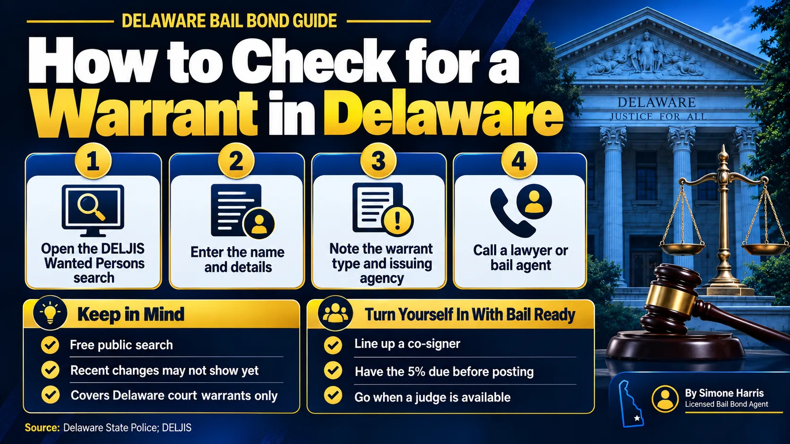

# Can a Bail Bondsman Check for Warrants? A Delaware Guide

Yes, a bail bondsman can help you check whether there's a warrant out for you, but in Delaware you don't need one to look. The state runs a free public search, the DELJIS Wanted Persons site, that shows active warrants and capiases issued by Delaware courts. Anyone can use it, including you, a family member or a bail agent.

Where a bail agent really helps is the next step. If there is a warrant, the agent can explain what bail is likely to look like and be ready to post a bond when you turn yourself in, so you spend as little time in custody as possible. This guide covers how to check, what the results mean, and how to resolve a warrant the smart way.

> Yes. A bail agent can check public warrant records for you, but in Delaware anyone can search the free DELJIS Wanted Persons site for active warrants and capiases issued by Delaware courts. If a warrant shows up, contact a lawyer or bail agent, then turn yourself in with a plan to post bail.

## How to Check for a Warrant in Delaware

The Delaware Criminal Justice Information System (DELJIS) runs the [Wanted Persons](https://pubsrv.deljis.delaware.gov/WantedPublic/) search. The Delaware State Police point people to it as the way to check whether there's an active warrant or capias for their arrest.

1. Go to the DELJIS Wanted Persons page.
2. Enter the name and the other details the form asks for.
3. Review any results: the type of warrant and the agency that issued it.
4. Write down what you find, including the issuing agency, before you call anyone.

Two cautions from the State Police are worth knowing. Recent changes may not show up in the online database right away, so a clean result isn't a guarantee. And the database only covers warrants from Delaware courts. A warrant from another state won't appear there.

## What a Bail Bondsman Can and Can't Do

A bail agent can run the same public search, read the result with you, and explain what usually comes next. An experienced agent also knows how the local courts handle walk-ins and how long processing tends to take.

A bail agent isn't law enforcement, though. Agents don't get special access to police systems because of their license, and they can't make a warrant go away or tell you what the judge will decide. They also can't arrest you over a warrant on someone else's bond. Under 24 Del. C. § 5506, only police and licensed bail enforcement agents can apprehend people who were released on bail. See [what a bail bondsman does](/blog/what-does-a-bail-bondsman-do) for the full picture.

## Will a Bail Bondsman Tell the Police?

People ask this a lot. Delaware's notice rule for bail agents, in [18 Del. C. § 4349](https://delcode.delaware.gov/title18/c043/sc02/index.html), applies to defendants who missed court on a bond the agent wrote. It requires the agent to notify police of that defendant's whereabouts. It isn't a rule about callers asking general questions.

That said, a bail agent isn't your lawyer, and what you tell them isn't protected the way a conversation with your attorney is. If your situation is complicated, talk to a defense attorney first.

## Types of Warrants You Might Find

| What shows up | What it usually means |
|---|---|
| Arrest warrant | A judge found probable cause for a new charge |
| Capias for failure to appear | You missed a court date; see our guide on [bail for a bench warrant](/blog/how-much-is-bail-for-a-bench-warrant) |
| Capias for unpaid fines or a probation issue | The court wants you back to deal with a missed payment or condition |

On a capias, Delaware court rules generally say bail is set as endorsed on the capias itself, and if none is endorsed, a judicial officer sets it. That's why some people can post bail quickly on a capias and others have to wait to see a judge.

## How to Turn Yourself In With Bail Ready

1. Confirm the warrant and the issuing agency through DELJIS.
2. Call a defense attorney, especially for a new felony charge.
3. Call a bail agent with the details so they can estimate what's needed and be on standby.
4. Line up a co-signer and the money for the amount due before posting.
5. Turn yourself in at the issuing agency or court during hours when you can see a judge.
6. Once bail is set, the agent posts the bond and the release paperwork starts.

Timing matters. Some Justice of the Peace courts in Delaware operate late into the night or around the clock, but going in on a Friday night can still mean a longer wait. Our guide on [whether you can bail someone out on the weekend](/blog/can-you-bail-someone-out-of-jail-on-the-weekend) explains why.

If the bond is secured, the premium in Delaware is 5% to 10% of a bond over $1,000, with at least 5% due before posting. A Way to Freedom Bail Bonds charges 10%. For the numbers, see [what percentage of bail you pay](/blog/what-percentage-of-bail-do-you-pay), and for the steps after the bond, [how to bond someone out of jail in Delaware](/blog/how-to-bond-someone-out-of-jail-delaware).

## Frequently Asked Questions

### Can a bail bondsman see if I have a warrant?

A bail agent can look at the same public records anyone can, such as Delaware's DELJIS Wanted Persons search. Agents don't get special access to police databases because of their bail license.

### Is the Delaware warrant search free?

Yes. The DELJIS Wanted Persons search is a free public site. The Delaware State Police encourage people to use it to check their own status.

### Is there a way to pay off a warrant?

Some capiases for unpaid fines can be resolved by paying what's owed or setting up a payment agreement with the court, but you should call the court that issued it to confirm. A warrant for a new charge or a missed court date usually needs a court appearance.

### Will I be arrested if I check for a warrant online?

No. Searching the site doesn't alert police or change your status. The State Police say the purpose is to let people find out and turn themselves in voluntarily.

### How long do you stay in jail if you can't pay your bond?

Until the bond is posted, a judge changes it, or the case ends. A defense attorney can ask the court to lower the amount or change the type; see [what a bond hearing is](/blog/what-is-a-bond-hearing).

### Can someone else check if I have a warrant?

Yes. The DELJIS site lets you check on yourself or another person.

## Get Ready Before You Walk In

Finding a warrant is stressful, but it's much easier to handle on your own schedule than at a traffic stop. A Way to Freedom Bail Bonds can go over what you found, explain the likely bond and the 10% premium, and be ready to post as soon as bail is set. [Contact us](/contact) any time, day or night. This article is general information about Delaware warrants and bail, not legal advice.
