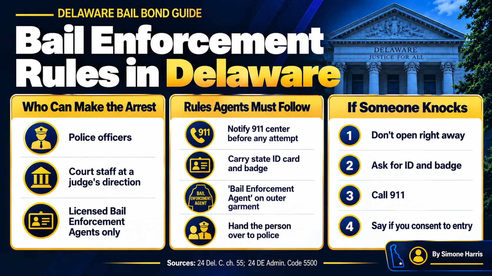

# Can a Bail Bondsman Enter Your Home? What Delaware Law Says

It depends on whose home it is and who is at the door. In Delaware, the person who comes looking for someone who skipped court usually isn't the bail bondsman. It's a licensed bail enforcement agent, the job most people call a bounty hunter. Delaware's statutes don't set out a specific rule on entering homes. What they do say is who can make the arrest, what license they need, and that they must alert the local 911 center before any attempt.

The answer also changes depending on whether the home belongs to the person who skipped bail or to someone else. This guide walks through what Delaware law covers, what it leaves open, and what to do if someone knocks.

> In Delaware, only police or a licensed bail enforcement agent may apprehend someone who skipped bail, and the agent must notify the local 911 center before any attempt. Delaware law doesn't spell out home-entry rules. Bail contracts often give consent for the defendant's own home, but entering a third party's home without consent is far riskier for the agent. If someone knocks, ask for ID and call 911.

## Who Can Arrest Someone Who Skipped Bail in Delaware

Under [24 Del. C. § 5506](https://delcode.delaware.gov/title24/c055/index.html), nobody other than a law enforcement officer, or a court employee acting at a judge's direction, may apprehend or detain a person who was released on bail unless they're licensed as a bail enforcement agent (BEA). The license is issued through the Delaware State Police Professional Licensing Section.

That means a bail agent who isn't also licensed as a BEA can't legally go out and grab someone. Under [18 Del. C. § 4349](https://delcode.delaware.gov/title18/c043/sc02/index.html), after a warrant or capias issues for missing court, a bail agent who knows where the defendant is must notify the nearest law enforcement agency. The agent may also hire a licensed BEA. Our guide on [what a bail bondsman does](/blog/what-does-a-bail-bondsman-do) explains how those two roles differ.

## The Rules a Bail Enforcement Agent Must Follow

Delaware's licensing law and the Board's regulations (24 Del. Admin. Code 5500) put real limits on how BEAs work:

| Rule | What it means for you |
|---|---|
| License required (§ 5506) | Anyone else who tries to detain a defendant is acting outside the law |
| ID card and badge on them while working (§ 5510) | You can ask to see both |
| 911 notice first (Reg. 8.1) | The agent must notify the local Public Safety Answering Point before going to the address, and again when leaving |
| Clothing rules (Reg. 2) | Outer garment must say "Bail Enforcement Agent" in full; no state or police seals |
| Custody goes to police (Reg. 8.2) | A person who is caught is turned over to law enforcement |
| Training (Reg. 6.2) | Includes the Bill of Rights, laws of arrest and search and seizure |

Breaking these rules can cost the agent their license, and acting without a license carries civil penalties.

## With a Warrant vs Without One

People often ask whether a warrant changes things. A capias or bench warrant is a court order directed to law enforcement. A bail enforcement agent's authority over a defendant traditionally comes from the bail contract, not from the warrant. So a warrant doesn't turn a BEA into a police officer, and police entering a home are bound by their own constitutional rules.

For what happens once a warrant issues, see [how much bail is for a bench warrant](/blog/how-much-is-bail-for-a-bench-warrant).

## The Defendant's Home vs Someone Else's Home

Here is where things get less certain, and where you should talk to a lawyer about your exact facts.

The defendant's own home is treated differently in bail law. An 1872 U.S. Supreme Court case, *Taylor v. Taintor*, described a bail surety's traditional power to arrest the person it bailed, including entering that person's home if necessary. Many bail contracts also include the defendant's written consent to be located and returned. Courts in different states have narrowed this old rule, and Delaware's statute doesn't address it directly.

A third party's home is a different matter. If the defendant is staying with a parent, partner or friend, that person didn't sign anything. Entering their home without consent exposes an agent to serious legal risk, which is one reason Delaware requires agents to coordinate with 911 and turn people over to police.

## What to Do If a Bail Bondsman or BEA Knocks

1. Stay calm and don't open the door right away. Talk through the door or a window.
2. Ask the person to show a Delaware BEA identification card and badge.
3. Call 911 and say who is at your door. The agent should already have notified the local dispatch center.
4. If you're the homeowner and the defendant doesn't live there, say clearly whether you consent to entry.
5. Don't lie about where the defendant is. Hiding someone with a warrant can create legal trouble of your own.

## If You're the One Who Missed Court

The safest move is to fix it yourself before anyone comes looking. Call your defense attorney and your bail agent right away. Many missed dates can be handled by turning yourself in or getting back on the court calendar, and acting fast can protect the co-signer's money and collateral. Our guide to [how bail bonds work in Delaware](/blog/how-bail-bonds-work-in-delaware) explains what the co-signer is on the hook for, and [do you get bail money back](/blog/do-you-get-bail-money-back) covers what happens to money after a missed date.

## Frequently Asked Questions

### Can a bail bondsman enter your home without permission in Delaware?

Delaware's statutes don't set a specific home-entry rule. The defendant's own bail contract may give consent, but entering someone else's home without consent is legally risky for the agent. In any case, only a licensed BEA or police can make the arrest, and the BEA must notify 911 first.

### How much authority does a bail bondsman have?

A Delaware bail agent writes and posts bonds and must report a skipped defendant's location to police. Arrests by anyone other than police are limited to licensed bail enforcement agents, who must follow state licensing rules and regulations.

### Can you refuse a bounty hunter?

If you're not the defendant and it's your home, you can say you don't consent to entry and call 911. Don't physically interfere or lie about the defendant's location. Ask a lawyer about your rights in your situation.

### Do you have to answer the door for a bail bondsman?

Generally, no. You can speak through the door, ask for identification and call 911 to confirm who is there.

### Can a bail bondsman carry a gun in Delaware?

A licensed BEA may carry a firearm only after completing at least 40 hours of approved training and qualification under the Board's regulations. Other equipment, like handcuffs or sprays, also requires training.

### Does a bail enforcement agent need a warrant?

A warrant is directed to police. A BEA's authority traditionally comes from the bail contract. Either way, the BEA must be licensed and must notify the local 911 center before an apprehension attempt.

## Questions About a Missed Court Date?

If someone you bailed out missed court, the fastest way to calm things down is to call. A Way to Freedom Bail Bonds can explain where the bond stands, what the co-signer should do, and how to get back in front of the court without a confrontation. [Contact us](/contact) any time, day or night. This article is general information about Delaware law, not legal advice. Questions about your rights in a specific situation belong with a lawyer.
