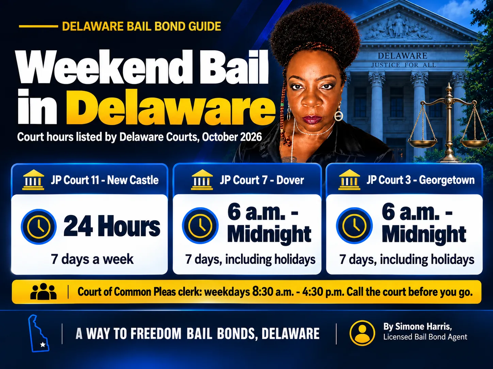

# Can You Bail Someone Out of Jail on the Weekend? Delaware Guide

Yes, in most cases you can bail someone out of jail on a weekend in Delaware. Arrests don't stop on Friday at 5 p.m., and neither does the bail system. As long as bail has been set and the bail type allows it, a licensed bail agent can post a bond on a Saturday, a Sunday or a holiday.

What changes on a weekend is the timing. Some courts keep short hours, some cases need a judge before anyone can be released, and a jail with a full weekend booking list moves slower. This guide covers which Delaware courts are open on weekends, what can be done right away, what usually waits for Monday, and the fastest way to get things moving.

> You can usually bail someone out on a weekend in Delaware once bail is set. Justice of the Peace Court 11 in New Castle runs 24 hours a day, and JP Courts 7 and 3 are open from 6 a.m. to midnight every day. A 24/7 bail agent can post a surety bond any day; no-bail holds wait for a judge.

## Yes, But Timing Depends on Two Things

The first is whether bail has been set. After an arrest, the person is booked and goes before a judicial officer, who decides the bail type and amount. Until that happens, there's nothing to post.

The second is the type of bail. Secured bail can be posted through a bail agent at any hour. Cash-only bail must be paid as money, and where that payment can be made depends on the court. If the judge ordered no bail, nobody can post anything until a judge reviews the case. Our guide on [secured bail vs cash-only bail in Delaware](/blog/secured-bail-vs-cash-only-bail-delaware) explains the difference.

## Which Delaware Courts Are Open on Weekends

Delaware's Justice of the Peace Courts handle a lot of after-hours criminal work. These are the hours listed on the Delaware Courts website as of October 2026:

| Court | Location | Hours |
|---|---|---|
| Justice of the Peace Court 11 | 2 Penns Way, Suite 100A, New Castle | 24 hours, 7 days a week |
| Justice of the Peace Court 7 | 480 Bank Lane, Dover | 6 a.m. to midnight, 7 days a week, including holidays |
| Justice of the Peace Court 3 | 23730 Shortly Road, Georgetown | 6 a.m. to midnight, 7 days a week, including holidays |
| Court of Common Pleas clerk (posting bond) | Clerk's Office | 8:30 a.m. to 4:30 p.m., Monday through Friday |

Court hours change, so call the court before you drive there. The [Delaware Courts locations page](https://courts.delaware.gov/locations/jpcourt.aspx) has the current details.

## What Can Happen on a Weekend, and What Waits for Monday

| Usually possible on a weekend | Usually waits for a weekday |
|---|---|
| Booking and a first appearance before a JP Court judicial officer | Cases where the judge ordered no bail and the person must see the trial court |
| A surety bond posted by a licensed bail agent | Paying cash bail at a court office that is only open on weekdays |
| Release once the facility processes the paperwork | Changing bail amounts or conditions (a motion to modify bond) |

If someone is held without bail over the weekend, a defense attorney is the right call. The bail agent can't change a court order, but can be ready the moment a judge sets an amount.

## Step by Step: Bailing Someone Out on a Saturday or Sunday

1. Find out where the person is being held and get their full name and date of birth.
2. Confirm whether bail has been set, and the type and amount. A bail agent can often check this for you.
3. Call a licensed Delaware bail agent who answers 24/7.
4. Sign the indemnity agreement and pay at least the amount due before posting.
5. The agent posts the bond with the court or facility.
6. Wait for release while the facility finishes its paperwork, and plan a ride home.
7. Write down the first court date and make sure the defendant keeps it.

For the full release process, see [how to bond someone out of jail in Delaware](/blog/how-to-bond-someone-out-of-jail-delaware).

## Why Weekend Release Can Take Longer

Posting bail on a weekend is possible. Getting out fast is a different question. Friday and Saturday nights often bring more arrests, so booking and first appearances can back up. Facilities may run with fewer staff overnight. And if bail needs a judge's decision, the wait depends on when the person is seen.

We won't promise a release time, and you should be cautious of anyone who does. The best thing you can do is have the details ready and call early, so the paperwork is waiting the moment bail is set.

## Does Bail Cost More on a Weekend?

It shouldn't. Under [18 Del. C. § 4347](https://delcode.delaware.gov/title18/c043/sc02/index.html), a surety bail agent must charge the premium rate filed with the Delaware Department of Insurance, which must be between 5% and 10% for a bond over $1,000, and can't add administrative or service fees that aren't filed and approved. There's no lawful "weekend surcharge."

A Way to Freedom Bail Bonds charges the same 10% premium on a Sunday at 3 a.m. as on a Tuesday afternoon, with at least 5% collected before posting. On a $5,000 bond, that's $500 in total and at least $250 up front. If paying all at once is hard, ask about [bail bond payment plans](/blog/how-do-bail-bond-payment-plans-work).

## Charges That May Not Get Weekend Release

Some cases are less likely to end in quick weekend release:

- Serious felonies where the judge may order a high bail or no bail
- Domestic violence arrests, which often come with no-contact conditions and closer review; see [bail for domestic violence in Delaware](/blog/how-much-is-bail-for-domestic-violence-delaware)
- Arrests on a capias (bench warrant) for a missed court date, where bail is whatever the judge endorsed or a magistrate sets
- Holds from another state or agency, which a bail bond doesn't release

In these cases, call a bail agent anyway. They can confirm what's been ordered and tell you whether anything can be done before Monday.

## What to Have Ready Before You Call

- The person's full legal name and date of birth
- Where they're being held, or the court that saw them
- The charge, if you know it
- The bail amount and type, if it has been set
- Your photo ID and a way to pay the amount due before posting

If you don't have all of this, call anyway. A bail agent can usually find the missing pieces.

## Frequently Asked Questions

### Can you get bail on a Saturday?

Yes. In Delaware, JP Court 11 operates 24 hours a day, and JP Courts 7 and 3 are open from 6 a.m. to midnight every day, so bail can be set and posted on a Saturday in most cases. No-bail holds wait for a judge.

### Can people be released from jail on a Sunday?

Yes. Once bail is set and posted, the facility can release the person on a Sunday. The time it takes depends on how busy the facility is and how quickly the paperwork is completed.

### What is the fastest way to get someone out of jail?

Have the person's full name, date of birth and location ready, confirm the bail type and amount, and call a 24/7 licensed bail agent right away. A surety bond is usually the fastest route when bail is secured.

### Can bail be granted on weekends?

Yes. Delaware's JP Courts handle bail decisions outside normal court hours. Cases where a judge ordered no bail, or that need the trial court, may have to wait for a weekday.

### Can I pay cash bail on a weekend?

Sometimes. It depends on the court and the bail order. Some court offices that accept bail payments are open only on weekdays, so call the court first. A bail agent can post a surety bond at any hour when the bail type allows it.

### Does a bail bondsman charge more on weekends?

No. In Delaware, the premium must match the agent's filed rate, between 5% and 10% for a bond over $1,000, and unfiled extra fees aren't allowed.

## Get Weekend Bail Help in Delaware

A weekend arrest doesn't have to mean waiting until Monday. If bail has been set, A Way to Freedom Bail Bonds can confirm the amount, explain the 10% premium and the 5% due before posting, and post the bond on a Saturday, a Sunday or a holiday. [Contact us](/contact) any time, day or night. This article is general information about Delaware bail, not legal advice; questions about the charges belong with a defense attorney.
