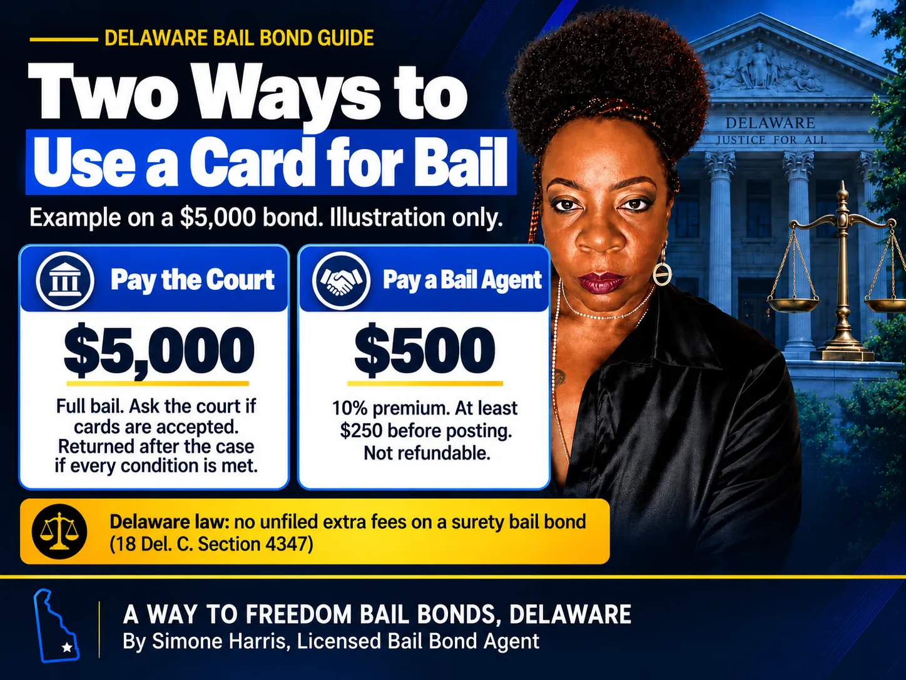

# Can You Pay Bail With a Credit Card? A Delaware Guide

Sometimes, yes. But "paying bail with a card" can mean two very different things. One is paying the full bail amount straight to the court. The other is paying a bail agent's premium so the agent posts a bond for you. Whether a card works, and what it costs, depends on which one you're doing.

In Delaware, the court sets the bail type and amount, and each court decides which forms of payment it accepts. A licensed bail agent sets its own accepted payment methods, but Delaware law controls what it can charge. This guide explains both routes, what to check before you swipe, and what to do if a card won't work.

> You can often use a credit or debit card for bail, but the rules differ. Paying the full bail directly to a Delaware court depends on what that court accepts, so call first. Paying a bail agent's premium by card is common, and the agent can't add unfiled extra fees under 18 Del. C. § 4347.

## Two Very Different Card Payments

| | Paying the court directly | Paying a bail agent |
|---|---|---|
| What you pay | The full bail amount | The premium (10% at A Way to Freedom), at least 5% before posting |
| Who decides if cards work | The court that set bail | The bail agency |
| Money back after the case | Generally returned to whoever posted it if every condition is met | The premium is not refunded |
| Typical use | You can afford the full amount | You need release without tying up the full amount |

## Paying the Court Directly in Delaware

Delaware doesn't publish one statewide list of payment methods for bail, and practices vary by court and by bail type. The Delaware Courts online payment system takes credit cards for things like Court of Common Pleas criminal fines and Justice of the Peace traffic tickets, but its ePayment page doesn't list bail among the online payments.

So before you drive anywhere, call the court that set the bail and ask:

- Do you accept credit or debit cards for bail on this case, or only cash and certified funds?
- Is there a card processing fee?
- Is there a limit on the amount that can be charged?
- Who will the bail be returned to after the case?

If the bail is cash only, a surety bond can't be used, so the court's payment rules decide everything. Our guide to [secured bail vs cash-only bail in Delaware](/blog/secured-bail-vs-cash-only-bail-delaware) explains the difference, and [what is a cash bond](/blog/what-is-cash-bond) covers how cash bail works.

## Paying a Bail Agent's Premium by Card

When the judge sets a secured bond, you can use a licensed bail agent instead of paying the full amount. You pay the premium, the agent posts the bond, and the court gets its guarantee. Many bail agencies take credit and debit cards for the premium, but each agency decides what it accepts, so ask when you call.

The numbers in Delaware are set by law. For a surety bond over $1,000, the total filed premium is between 5% and 10%, and at least 5% must be paid before posting. A Way to Freedom Bail Bonds charges 10%.

| Bond amount | Total premium (10%) | Due before posting (5%) |
|---|---|---|
| $1,000 | $100 | Ask the agent (the 5% rule covers bonds over $1,000) |
| $5,000 | $500 | $250 |
| $50,000 | $5,000 | $2,500 |
| $75,000 | $7,500 | $3,750 |

If paying all of it at once is hard, a [bail bond payment plan](/blog/how-do-bail-bond-payment-plans-work) can spread the balance over time, which may cost less than carrying it on a high-interest card.

## Can a Co-Signer Use Their Card?

Usually, yes. Families often split the premium, and the person paying doesn't have to be the defendant. Keep in mind that the person who signs the indemnity agreement takes on responsibility if the defendant misses court. Paying with your card and signing as co-signer are two separate commitments, so understand both before you agree. Our guide on [how bail bonds work in Delaware](/blog/how-bail-bonds-work-in-delaware) explains the co-signer's role.

## Card Surcharges and Delaware's Fee Rule

A court or a card processor may charge a convenience fee when you pay bail directly. That's between you and the court, so ask about it up front.

With a bail agent, Delaware is stricter. Under [18 Del. C. § 4347(c)](https://delcode.delaware.gov/title18/c043/sc02/index.html), a surety bail agent can't charge administrative fees, service charges or similar fees unless they were filed with and approved by the Delaware Department of Insurance. If an agent quotes a "card fee" or "processing fee" on top of the premium, ask whether it's a filed, approved charge.

## Is Using a Card a Good Idea?

A card makes sense when it gets someone home tonight and you have a clear plan to pay it off. It also gives you a record of the payment.

The downside is interest. If the balance sits on a card for months, the interest can add up to more than the premium itself. And paying the full bail amount by card to the court means carrying a large balance until the case ends and the money comes back, which can take months. Read [do you get bail money back](/blog/do-you-get-bail-money-back) to see when money is returned and when it isn't.

## Options If a Card Won't Work

- Use a bail agent instead of paying the full amount, if the bond is secured.
- Ask about a written payment plan for the premium balance.
- Pool money from family members, each paying part of the amount due before posting.
- Ask a defense attorney about a motion to lower the bail or change the bond type; see [what a bond hearing is](/blog/what-is-a-bond-hearing).
- If the bond is unsecured or a conditions of release bond, no money is needed to get out; see [what is unsecured bail](/blog/what-is-unsecured-bail-delaware).

## Frequently Asked Questions

### Can you pay bail with a credit card in Delaware?

Often, but it depends on who you're paying. For the full bail amount, ask the court that set the bail which payment methods it accepts. For a bail agent's premium, ask the agency; many accept cards.

### How much is a $1,000 bail bond?

At a 10% premium, a $1,000 bail bond costs $100. Delaware's 5% minimum before posting applies to surety bonds over $1,000, so ask the agent what's due up front on a $1,000 bond.

### Why do you only pay 10% on bail?

Because you're not paying the bail itself. The bail agent guarantees the full amount to the court, and the 10% is the agent's premium for that guarantee. In Delaware the filed premium on a surety bond over $1,000 must be between 5% and 10%.

### What does $50,000 cash bail mean?

It means the full $50,000 must be paid in money to the court, and a surety bond can't be used. If the bail were secured instead of cash only, a bail agent could post it for a premium of $5,000 at 10%.

### How much does a $75,000 bail bond cost?

At a 10% premium, $7,500, with at least $3,750 due before posting in Delaware. The agent may also ask for collateral on a bond that size.

### Can I pay a bail bondsman with a debit card?

Many agencies accept debit cards as well as credit cards. Ask the agent which methods it accepts and get a receipt for every payment.

## Get Help Paying for Bail in Delaware

A card can be a fast way to get someone home, as long as you know who you're paying and what it really costs. A Way to Freedom Bail Bonds can confirm the bail type and amount, explain the 10% premium and the 5% due before posting, and walk you through the payment options available for your bond. [Contact us](/contact) any time, day or night. This article is general information about Delaware bail, not legal or financial advice.
