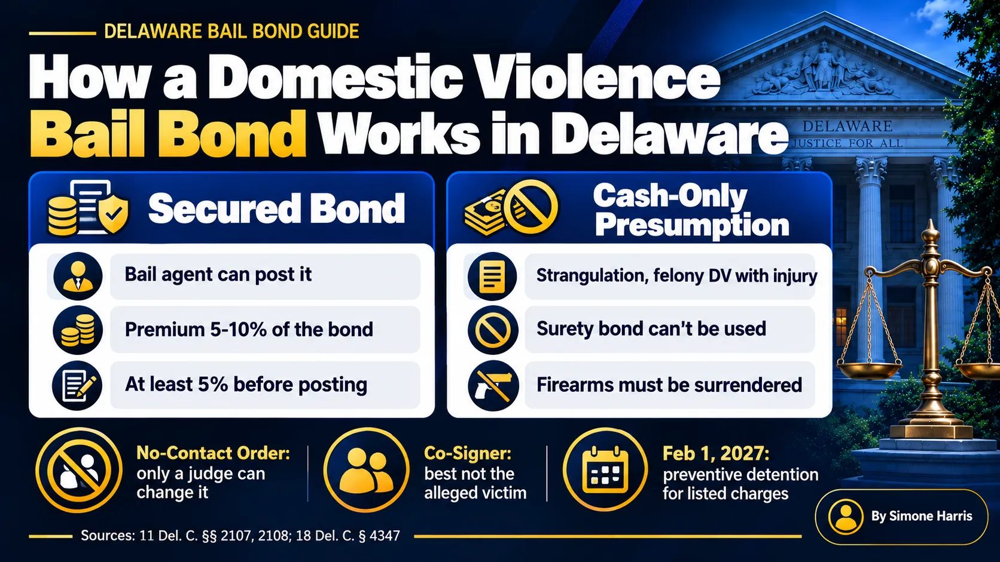

# Domestic Violence Bail Bonds in Delaware: How They Work

A bail bond on a domestic violence charge works like any other bail bond in one way: if the judge sets a secured bond, a licensed bail agent can post it for a premium. But DV cases come with extra rules that change what a family can do. Some serious DV charges start with a presumption of cash-only bail, which a surety bond can't cover. Almost every DV release comes with a no-contact order. And the person who wants to help the most is sometimes the one person who shouldn't be involved.

This guide covers how a bail agent fits into a Delaware domestic violence case, when a bond can't be used, what the conditions mean for everyone involved, and how to avoid the mistakes that send people back to jail. If your main question is the dollar amount, start with our guide to [how much bail is for domestic violence in Delaware](/blog/how-much-is-bail-for-domestic-violence-delaware).

> A bail agent can post a domestic violence bond in Delaware when the judge sets a secured bond, for a premium of 5% to 10%. For strangulation and felony DV causing injury, current law presumes cash-only bail, which a surety bond can't satisfy. Release almost always includes a no-contact order, and breaking it can mean a new charge and jail.

## How a Bail Bond Works on a Domestic Violence Charge

After the arrest, the person goes before a judicial officer, usually at the Justice of the Peace Court. The judge picks one of four bond types under [11 Del. C. § 2104](https://delcode.delaware.gov/title11/c021/index.html) and adds conditions. If the bond is secured, the family has two choices: deposit the full amount with the court, or hire a licensed bail agent.

With an agent, you pay a premium and sign a written agreement, and the agent posts the bond. Under [18 Del. C. § 4347(b)](https://delcode.delaware.gov/title18/c043/sc02/index.html), the premium on a surety bond over $1,000 is between 5% and 10%, with at least 5% paid before posting. A Way to Freedom Bail Bonds charges 10%.

| DV bond set by the judge | Total premium (10%) | Due before posting (5%) |
|---|---|---|
| $2,500 secured | $250 | $125 |
| $10,000 secured | $1,000 | $500 |
| $30,000 secured | $3,000 | $1,500 |
| Any amount, cash only | A surety bond can't be used | Full cash, or a property bail agent |

For the full breakdown of who pays what, see [what percentage of bail you pay](/blog/what-percentage-of-bail-do-you-pay).

## When Delaware Presumes Cash-Only Bail

Delaware treats some DV charges more strictly from the start. Under the version of 11 Del. C. § 2107(c) in effect as of October 2026, for certain listed offenses the presumption is that the court sets bail secured by cash only. The list includes:

- Strangulation
- Abuse of a pregnant female in the first degree
- Felony domestic violence offenses that cause physical injury or serious physical injury
- A violent felony against the same victim while a DV case is already pending, and the reverse

Cash only means a surety bond can't be used. The family either pays the full amount to the court, or uses a property bail agent, who posts cash bail for a charge of 20% to 30% under § 4347(f). The law also requires the defendant to give up any firearms when bail is set under that list, and it allows a later bail review to consider a different amount or type of security.

Our guide to [secured bail vs cash-only bail in Delaware](/blog/secured-bail-vs-cash-only-bail-delaware) explains the difference, and [what a cash surety bond is](/blog/what-is-a-cash-surety-bond) covers orders that allow either one.

## The No-Contact Order Comes With the Bond

Under § 2108, a judge can order a defendant to have no contact, or restricted contact, with the alleged victim, the victim's family, home, workplace or school. In DV cases, this is close to standard. Other common conditions include staying away from the home, alcohol or drug limits, and check-ins.

These conditions are part of the bond. Breaking one isn't a small slip. It can lead to a new charge for noncompliance with bond conditions, a warrant, and the bond being revoked. Our guide on [bail for a bench warrant](/blog/how-much-is-bail-for-a-bench-warrant) covers what happens after a warrant issues.

A few things families often get wrong:

- The no-contact order binds the defendant, and only a judge can change it. The alleged victim can't waive it.
- Contact through a friend, relative or social media still counts as contact.
- If the order bars the defendant from the home, they need somewhere else to stay before release. Plan that before the bond is posted.

## Who Should Co-Sign a Domestic Violence Bond

The co-signer, or indemnitor, promises the bail agent that the defendant will go to court, and takes on the financial risk if they don't. In DV cases, the alleged victim sometimes wants to be that person. It's a situation to think through carefully.

The defendant can't call or message the alleged victim to arrange the bond if a no-contact order is in place. And signing as co-signer doesn't change the order. It's usually safer for another family member or friend to handle the bond and the paperwork. A good bail agent will ask about the conditions before deciding who signs. For what the role involves, read [how bail bonds work in Delaware](/blog/how-bail-bonds-work-in-delaware).

## What Changes on February 1, 2027

Delaware's updated bail law takes effect on February 1, 2027. For DV cases, two changes stand out. First, in suspected domestic or intimate partner violence, courts must also consider a tool that assesses the risk of future violence against the alleged victim, when one is available. Second, the new § 2116 lets courts order preventive detention, meaning no bail at all after a hearing, for a list of charges that includes strangulation and felony DV causing injury.

So for the most serious DV charges, the question after February 2027 may be whether release happens at all, not just how much it costs. Our guide to [cashless bail and Delaware's 2027 changes](/blog/what-is-cashless-bail) has the wider picture, and [what a bond hearing is](/blog/what-is-a-bond-hearing) explains the hearing itself.

## How to Get a DV Bail Bond in Delaware

1. Find out where the person is held and confirm the charge, bond type and amount.
2. Ask for the written conditions, especially any no-contact or stay-away terms.
3. If the bond is secured, call a licensed bail agent and give them the booking details.
4. Decide who will co-sign, keeping the no-contact order in mind.
5. Pay the amount due before posting and sign the written agreement. Get receipts.
6. Arrange a place for the defendant to stay if they can't go home.
7. After release, follow every condition and keep every court date.

DV arrests often happen at night or over the weekend. See [whether you can bail someone out on the weekend](/blog/can-you-bail-someone-out-of-jail-on-the-weekend), and if the premium is hard to cover at once, ask about [bail bond payment plans](/blog/how-do-bail-bond-payment-plans-work).

## Frequently Asked Questions

### Can you get a bail bond for a domestic violence charge in Delaware?

Yes, if the judge sets a secured bond. A licensed bail agent can post it for a premium of 5% to 10% of the bond. If the bail is cash only, a surety bond can't be used.

### Can bail be granted in a domestic violence case?

In most Delaware DV cases, yes, with conditions such as a no-contact order. For certain serious charges, current law presumes cash-only bail, and from February 1, 2027, courts can order preventive detention for a listed set of offenses after a hearing.

### Can the victim bail out the defendant?

Legally, there may be nothing stopping them from paying, but it's risky. The defendant can't contact them to arrange it if a no-contact order is in place, and co-signing doesn't change the order. It's usually better for someone else to handle the bond.

### Can the alleged victim drop the no-contact order?

No. It's a court order on the defendant. Only a judge can change it, usually after a motion from the defense attorney.

### What happens if a no-contact order is violated?

The defendant can face a new charge, a warrant and revocation of the bond. The bail agent may also surrender the bond, and the co-signer can be held to the agreement.

### Do DV bail bonds cost more?

The premium rate is the agent's filed rate, so it doesn't go up because a charge is DV-related. What can change is the bail amount and the bond type, which the judge sets based on the charge and safety concerns.

## Get Help With a Domestic Violence Bail Bond in Delaware

A DV arrest is hard on everyone in the family, and the rules leave little room for mistakes. A Way to Freedom Bail Bonds can confirm the bond type and amount, explain the conditions that come with release, and handle the paperwork any time, day or night. [Contact us](/contact). This article is general information about Delaware bail, not legal advice. Questions about the charge or the no-contact order belong with a defense attorney. If you are in danger, call 911.
