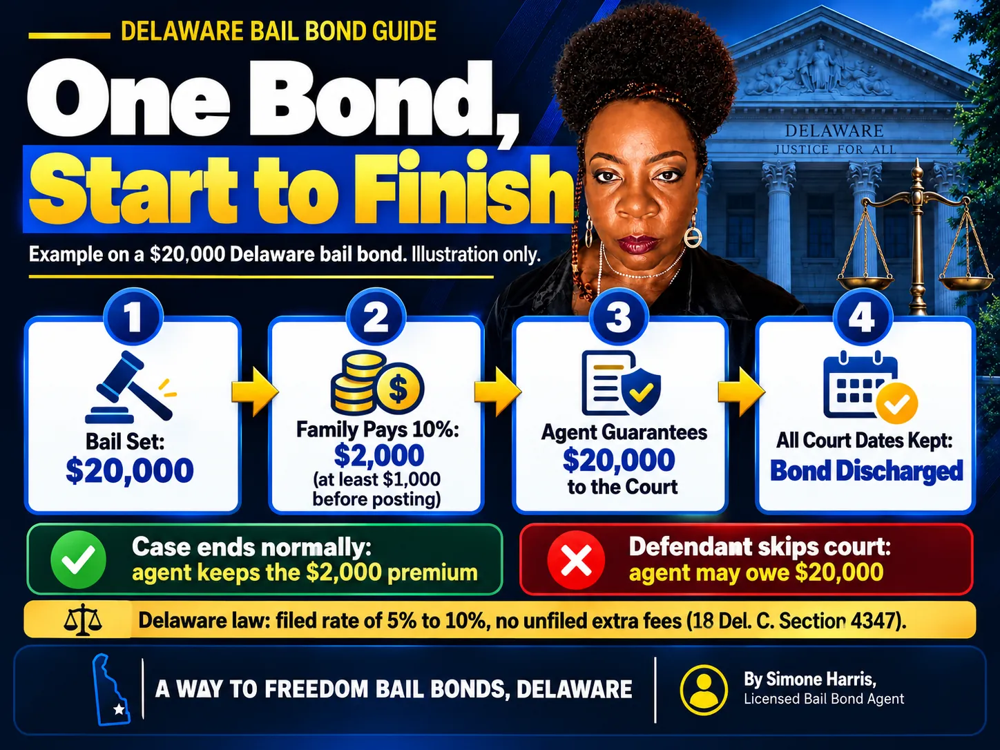

# How Does a Bail Bond Make Money? A Delaware Look Inside the Premium

A bail bond company makes money from one main thing: the premium. When an agent posts a bond, it promises the court the full bail amount if the defendant doesn't show up. In exchange, the family pays a fee, usually a percentage of the bail, and that fee is the company's income. It isn't refunded, because the service has been delivered the moment the person walks out of jail.

That's the simple version. The fuller picture explains why the premium is set the way it is, why agents ask for co-signers and sometimes collateral, and how a single missed court date can wipe out the profit from dozens of bonds. In Delaware, state law also limits what an agent can charge, which protects families from surprise fees.

> A bail bond makes money through the premium the agent charges to post the bond. In Delaware, the premium on a surety bond over $1,000 must match the agent's filed rate of 5% to 10%, and unfiled extra fees aren't allowed. The agent's risk is forfeiture if the defendant misses court.

## The Premium: Where the Money Comes From

The premium is a fee for a guarantee. The bail agent, backed by an insurance company called a surety, promises the court the full bond amount. The family pays a percentage of that amount to get the guarantee.

On a $20,000 bond at a 10% premium, the family pays $2,000. The court gets the bond, the defendant gets released, and the agent earns the premium. If every court date is kept, the bond is discharged when the case ends and the agent never has to pay the court anything.

That's also why the premium isn't returned when charges are dropped. It paid for the release, not for the outcome. Our guide on [whether you get bail money back](/blog/do-you-get-bail-money-back) explains which money does and doesn't come back.

## Delaware's Rules on What an Agent Can Charge

Delaware doesn't leave pricing to each agency. Under [18 Del. C. § 4347](https://delcode.delaware.gov/title18/c043/sc02/index.html):

- The premium can't be higher or lower than the rate the agent filed with the Delaware Department of Insurance.
- For a surety bond over $1,000, the total filed premium must be between 5% and 10% of the bond.
- The agent can't post the bond without first receiving at least 5% and signing a written contract with the family.
- Administrative fees, service charges, company or agent fees that weren't filed and approved are not allowed.

A Way to Freedom Bail Bonds charges 10%, with at least 5% collected before posting. For a closer look at the numbers, see [how much a surety bond costs](/blog/how-much-is-a-surety-bond) and [how much a bail bond costs in Delaware](/blog/how-much-does-a-bail-bond-cost-in-delaware).

## Where the Premium Goes

The agent doesn't keep every dollar. Part of each premium typically goes to the surety company that backs the bond, and agencies often set aside part of it in a reserve to cover future losses. The rest pays for the agency itself: licensed agents on call 24 hours a day, office costs, insurance, and the staff time spent tracking court dates and staying in touch with defendants.

How the premium is split depends on each agency's contract with its surety, so there isn't one statewide number. What is fixed is what the family pays: the filed rate.

## One Bond, Start to Finish: A Delaware Example

| Step | What happens | Money involved |
|---|---|---|
| Bail is set | The judge sets a $20,000 secured bond | $20,000 owed to the court only if the defendant fails to appear |
| Premium is paid | The family pays the 10% premium; at least 5% is due before posting | $2,000 total, at least $1,000 up front |
| Bond is posted | The agent guarantees $20,000 to the court | The agent is now at risk for $20,000 |
| Case ends normally | Every court date is kept and the bond is discharged | The agent keeps the $2,000 premium |
| Defendant skips court | The court can forfeit the bond | The agent may owe $20,000 and tries to recover it |

## How a Bail Agent Loses Money

Forfeiture is the big risk. Under 11 Del. C. § 2113, when a defendant fails to appear, the court issues a warrant and can forfeit the bond. Delaware law says no cash, property or surety can be forfeited except for a failure to appear, so a bond that's kept in good standing never costs the agent anything.

When a bond is forfeited, one skip can erase the premium income from many bonds. That's why agents look closely at the co-signer, the person's ties to the community and their court history before agreeing to a bond. It's also why agents remind clients about every court date. A defendant who shows up is the whole business model.

Section 4347(d) lets the bond agreement give the agent a right to recover from the defendant or co-signer after a breach, limited to the bond amount plus reasonable, receipted expenses. If a court date is missed, our guide on [bail for a bench warrant](/blog/how-much-is-bail-for-a-bench-warrant) explains what happens next.

## Collateral Is Security, Not Profit

Some bonds also need collateral, such as a vehicle title or property. Collateral isn't income. Under 18 Del. C. § 4348, collateral has to be reasonable for the size of the bond and receipted, and Delaware limits who it can be transferred to. It's returned under the agreement once the bond is discharged.

Collateral only matters to the agent if the defendant skips and the agent has to cover a forfeiture. For families, the key is to get a written receipt and know exactly what will be returned and when.

## Cash Bail Through a Property Bail Agent

Delaware also licenses property bail agents, who can post cash bail for someone. Their charge is set differently: under § 4347(f), it must be between 20% and 30% of the cash bail, with at least 20% received before posting. That's higher because the agent puts up actual cash, not a surety promise. The difference is explained in [secured bail vs cash-only bail in Delaware](/blog/secured-bail-vs-cash-only-bail-delaware) and [what a cash surety bond is](/blog/what-is-a-cash-surety-bond).

## What This Means for Families

- Ask for the agent's premium rate and the total in dollars before you sign.
- Expect at least 5% due before posting on a surety bond over $1,000.
- Question any extra fee. If it isn't a filed, approved charge, Delaware law doesn't allow it.
- Get a receipt for every payment and for any collateral.
- Keep every court date. It protects the defendant, the co-signer and any collateral.

If paying the premium at once is hard, ask about [bail bond payment plans](/blog/how-do-bail-bond-payment-plans-work).

## Frequently Asked Questions

### How do bail bonds make profit?

Through the premium. The agent charges a percentage of the bail to post the bond and keeps that fee once the person is released. Profit depends on defendants keeping their court dates, since a forfeited bond can cost the agent the full bail amount.

### How does a bail bondsman lose money?

When a defendant skips court and the bond is forfeited. The agent may have to pay the full bond to the court and then try to recover it from the defendant or co-signer.

### How much do bail bondsmen make?

It varies widely with the number of bonds written, their size, the agency's surety contract and how many forfeitures it absorbs. There's no reliable single figure, and the premium a family pays is fixed by the filed rate, not by what the agent wants to earn.

### How much is bail on a $100,000 bond?

If you pay cash, the full $100,000 goes to the court. Through a bail agent at 10%, the premium is $10,000, with at least $5,000 due before posting in Delaware. Collateral may also be requested on a bond that size.

### Can a bail bondsman charge extra fees in Delaware?

Only charges that are filed with and approved by the Delaware Department of Insurance. Administrative, service, company or agent fees that weren't filed and approved are not allowed under § 4347(c).

### Is the bail bond premium refundable?

No. The premium pays for posting the bond and isn't returned when the case ends, even if charges are dropped. Collateral is different and is returned under the agreement.

## Get Clear Answers About Your Bail Bond

A bail bond works because the agent takes a risk and the family pays a fixed, filed premium for it, nothing hidden, nothing extra. A Way to Freedom Bail Bonds charges 10% with at least 5% before posting, explains every number in writing and answers the phone any time. [Contact us](/contact) if someone you love needs help with bail in Delaware. This article is general information about Delaware bail, not legal or financial advice.
