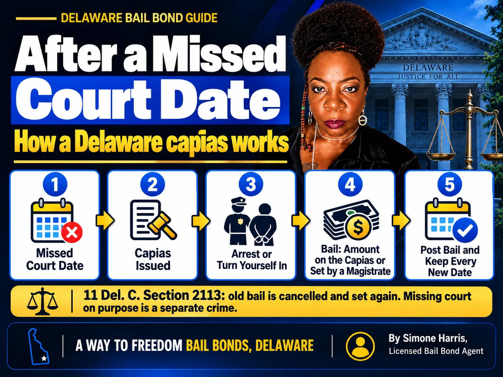

# How Much Is Bail for a Bench Warrant? Delaware Capias Bail Explained

There isn't a set price for bail on a bench warrant. In Delaware, a bench warrant is usually called a capias, and the bail is whatever amount the judge wrote on it. If no amount was written, the magistrate who sees the person after the arrest decides. That amount can be very different from the bail in the original case.

Most people find out about a capias the hard way: a missed court date, a letter that never arrived, or a traffic stop. The good news is that a capias can almost always be dealt with, and the earlier you deal with it, the more options you have. This guide explains how capias bail works in Delaware, what a "no bail" warrant means, what a bail bond would cost, and the steps to take now.

> Bail on a bench warrant has no fixed amount. In Delaware, bail on a capias is the amount endorsed on the capias by the court. If none is endorsed, the committing magistrate sets bail based on the circumstances. A licensed bail agent can usually post it for a premium of up to 10%.

## Is There a Set Bail Amount for a Bench Warrant?

No. A bench warrant doesn't have its own price list. The amount depends on the original charge, why the warrant was issued, the person's history of showing up to court, and what the judge decided when signing it.

That's why two people with "a bench warrant" can face very different bail. One might have a few hundred dollars endorsed on a traffic case. Another might be held with no bail on a felony case until a judge reviews it.

## Bench Warrant vs Capias in Delaware

Delaware courts use the word **capias** for a court-issued warrant that tells police to bring a person before the court. It's the Delaware version of what other states call a bench warrant. A capias is commonly issued when someone misses a court date or doesn't pay a court-ordered amount.

A capias is not the same as the arrest warrant police get when a new crime is charged. It comes from the court where the case is already pending, and it is about getting the person back in front of that court.

## How Bail Is Set on a Delaware Capias

The Court of Common Pleas criminal rules spell it out. Under Rule 4(f), a capias is executed the same way as an arrest warrant. The person is brought before the court if it's in session, or otherwise before the nearest available magistrate. The rule then says bail is fixed as endorsed on the capias, or, if nothing is endorsed, as the committing magistrate deems appropriate.

| Situation | Who sets the bail | What it usually means |
|---|---|---|
| Amount endorsed on the capias | The judge who issued it | Bail can be posted once the amount and type are confirmed |
| No amount endorsed | The committing magistrate | Bail is set at the first appearance after the arrest |
| No bail ordered | The judge | The person stays in custody until the court reviews it |

To find out whether bail is endorsed and how much, call the court that issued the capias or a licensed bail agent. Our guide on [how to find out someone's bail amount](/blog/how-do-you-find-out-how-much-someones-bail-is) walks through what to ask.

## What Is a "No Bail" Warrant?

A no-bail warrant, sometimes called a warrant without bail, means the judge wants to see the person before any release. Nobody can post money or a bond to get them out right away. They are held until the court reviews their case, usually at the next available session.

No-bail capiases are more common after repeated missed dates, a violation of release conditions, or a serious underlying charge. A defense attorney can ask the court for a prompt hearing.

## What Can Change the Amount

The judge looks at the same kinds of things as at any bail decision, plus the missed appearance itself:

- The seriousness of the original charge, felony or misdemeanor
- Whether this was the first missed date or one of several
- Whether there was a good reason, such as a hospital stay or a notice that never arrived
- Any new arrests or broken release conditions
- How long the person waited before dealing with the capias

Turning yourself in and bringing proof of why you missed court won't guarantee a lower amount, but it gives the judge a reason to see you differently from someone picked up months later.

## What a Bail Bond Costs on a Bench Warrant: Examples

If the capias bail allows a surety bond, a licensed bail agent can post it. Under [18 Del. C. § 4347](https://delcode.delaware.gov/title18/c043/sc02/index.html), the total premium on a surety bail bond over $1,000 must be between 5% and 10%, and at least 5% must be paid before posting. A Way to Freedom Bail Bonds charges 10%.

| Capias bail | Total premium (10%) | Minimum before posting (5%) |
|---|---|---|
| $2,500 | $250 | $125 |
| $10,000 | $1,000 | $500 |
| $25,000 | $2,500 | $1,250 |

These are illustrations, not quotes. If the capias is cash only, a surety bond can't be used; see [secured bail vs cash-only bail in Delaware](/blog/secured-bail-vs-cash-only-bail-delaware). For the remaining balance, ask about [bail bond payment plans](/blog/how-do-bail-bond-payment-plans-work).

## What Happens After a Missed Court Date in Delaware

Delaware law is direct about it. Under [11 Del. C. § 2113](https://delcode.delaware.gov/title11/c021/index.html) (the version in effect as of October 2026), when a defendant fails to appear, the court issues a warrant, the existing bail is cancelled, and the defendant goes back before the court so bail can be decided again.

The same section says no cash, property or surety can be forfeited except for a failure to appear, so the original bond is at risk once a court date is missed. If a bail agent posted it, the co-signer may owe the agent under the indemnity agreement.

Knowingly missing court is also a separate crime under § 2113(c). If the person was out on a felony charge, it can be punished by up to 5 years in prison, a $5,000 fine, or both. On a misdemeanor charge, it can mean up to 1 year or a $500 fine, or both. A good reason for missing court matters, which is another reason to deal with a capias quickly and with a lawyer's help.

## What to Do If You Have a Bench Warrant

1. Confirm the capias: which court issued it, the case number, and whether bail is endorsed.
2. Call a criminal defense attorney, or Delaware's Office of Defense Services (the public defender), before you do anything else.
3. Gather proof of why you missed court, such as hospital records or a notice that went to an old address.
4. Plan to turn yourself in at a time that suits you, instead of waiting to be picked up at work or home.
5. Line up bail help in advance so a bail agent is ready if an amount is endorsed or set.
6. After release, keep every new court date and update the court within 5 days if you move, as § 2113 requires.

Delaware courts have also held Safe Surrender events in the past, where people with a capias could turn themselves in and have the matter handled by a judge. Check the Delaware Courts website for any upcoming dates.

## Frequently Asked Questions

### Can you bail out of jail on a bench warrant?

Usually, yes. If an amount is endorsed on the capias or set by the magistrate, it can be posted in cash or, if allowed, through a bail agent. If the capias says no bail, the person stays in custody until the court reviews it.

### How long do you stay in jail for a bench warrant?

It depends on the bail. With an endorsed amount, release can follow once bail is posted and processed. With no bail, the person is held until the court can see them, which is often the next session but can be longer.

### Is bail higher on a bench warrant than on the original charge?

It can be. A missed court date tells the judge there's a risk of not appearing, so the new bail is often higher or stricter than the first, though a good reason for missing court can help.

### What is a warrant without bail?

It's a warrant that doesn't allow release until a judge reviews the case. No amount can be posted until the court sets bail at a hearing.

### What happens to the bail I already paid?

Under § 2113, the existing bail is cancelled and the court decides bail again. Cash, property or a surety bond can be forfeited for a failure to appear. If a bail agent posted the bond, the co-signer may owe the agent.

### Can a bail bondsman help with a capias?

Yes, if bail is endorsed or set and a surety bond is allowed. In Delaware the premium is up to 10%, and at least 5% of a bond over $1,000 must be paid before posting.

## Get Help With a Bench Warrant Bond in Delaware

A bench warrant feels like it locks every door, but in Delaware the path is fairly clear: confirm the capias, find out whether bail is endorsed, get legal advice, and turn yourself in with help lined up. A Way to Freedom Bail Bonds can check the bail on a capias, explain the 10% premium and the 5% due before posting, and have paperwork ready before you walk in. [Contact us](/contact) any time, day or night. This article is general information about Delaware bail, not legal advice; questions about the case itself belong with a defense attorney.
