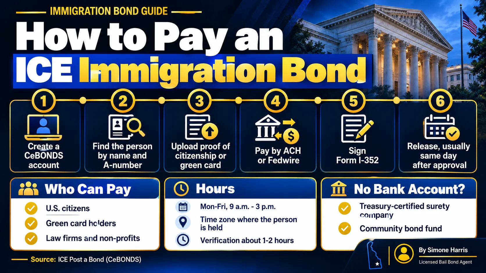

# How to Pay an Immigration Bond: ICE CeBONDS Step by Step

Most immigration bonds are now paid online through ICE's Cash Electronic Bonds system, called CeBONDS. The person paying, called the obligor, creates an account, proves they're eligible, and sends the full bond amount by bank transfer. ICE reviews the payment and the bond contract, and the detained person is usually released later that day once everything is approved.

There are rules that catch families off guard: only certain people can pay, cards and cash aren't accepted online, and bonds are only processed on weekday afternoons. This guide walks through each step so the money goes through the first time.

> To pay an immigration bond, the obligor registers on ICE's CeBONDS site, enters the detained person's name and A-number, uploads proof of U.S. citizenship or permanent residence, and pays the full amount by ACH or Fedwire. Bonds are processed Monday to Friday, 9 a.m. to 3 p.m. in the time zone where the person is held. Verification usually takes 1 to 2 hours.

## Before You Pay: Three Things to Confirm

1. Confirm the bond amount and type. The amount is set by the Department of Homeland Security or by an immigration judge after a bond hearing, and a cash bond has to be paid in full when it's posted. Our guide to the [immigration bond hearing](/blog/immigration-bond-hearing) explains how the amount gets set.
2. Get the detained person's full name and A-number (alien registration number) exactly as ICE has them.
3. Decide who will be the obligor. That person signs the bond contract and takes on its duties, so choose carefully.

## Who Can Pay an Immigration Bond

ICE says CeBONDS can be used only by people inside the United States, and only by:

- U.S. citizens
- Lawful permanent residents (green card holders)
- Law firms and non-profit organizations, through an authorized representative

A detained person can post a voluntary departure bond or an order of supervision bond for themselves, but a delivery bond, the most common type, has to be posted by an eligible obligor.

| Obligor | Documents ICE accepts (at least one) |
|---|---|
| U.S. citizen | U.S. passport, U.S. birth certificate, naturalization certificate, consular report of birth abroad, REAL ID driver's license or state ID, military ID |
| Permanent resident | Green card or military ID |
| Law firm or non-profit | IRS EIN letter (or IRS Letter 947 for non-profits), authorization letter and the representative's ID |

## How to Pay Through CeBONDS, Step by Step

1. Go to ICE's [Post a Bond page](https://www.ice.gov/detain/detention-management/bonds) and choose the option to post a bond.
2. Create a secure CeBONDS account and sign in.
3. Search for the detained person using their name and A-number. If the system can't find them, double-check the details, then call the nearest ICE field office.
4. Upload your eligibility document.
5. Pay the full bond amount by ACH (a transfer from your bank account) or Fedwire (a bank wire).
6. Review and sign the Form I-352 bond contract.
7. Watch your CeBONDS account and email for approval and any notices.

ICE says the review of the bond contract and payment typically takes about 1 to 2 hours, depending on staffing and the case. Requests that come in after posting hours roll to the next business day.

## Payment Methods and Hours

Online bond payments must be made by ACH or Fedwire. That means the money has to come from a bank account. Credit cards and cash aren't options in CeBONDS.

Bond posting hours are Monday through Friday, 9 a.m. to 3 p.m., excluding federal holidays, in the time zone where the person is detained. For someone held on the East Coast, a request finished at 3:30 p.m. on a Friday won't be processed until Monday.

If you don't have a bank account, ICE says you can work with an immigration bond company from the Treasury Department's list of certified surety companies, or with a community organization that helps with bonds. ICE may also handle some in-person payments at a field office case by case, but you'll still need access to banking services.

## What Happens After You Pay

ICE says people are typically released by the end of the day after the bond is approved and the I-352 is signed, though the detention facility's processing time can vary. Plan transportation ahead, since release may be from a facility far from home.

Paying the bond starts the obligor's duties, which don't end at release:

- On a delivery bond, the obligor must make sure the person reports to ICE every time ICE sends a notice to deliver (Form I-340).
- Keep your mailing address current with ICE using Form I-333. A missed notice can lead to a breach.
- The bond stays in effect until ICE issues a cancellation notice (Form I-391).

If the conditions are met and the bond is cancelled, the money can be refunded. If ICE declares a breach, the deposit is forfeited, though ICE still refunds the interest that accrued on it. Our guide to [immigration bond refunds](/blog/immigration-bond-refund) covers the refund process, and the forms are explained in [ICE bond forms I-352 and I-286](/blog/ice-bond-forms-i-352-i-286).

## Cash Bond vs Using an Immigration Bond Company

| | Pay ICE directly (cash bond) | Immigration bond company (surety) |
|---|---|---|
| What you pay | The full bond amount | A premium plus any collateral the company requires |
| Refundable | Yes, after cancellation if the terms were met | The premium isn't |
| Bank account needed | Yes (ACH or Fedwire) | Ask the company |
| Who is responsible | You, as obligor | The company, with you bound by your agreement with it |

A surety route can help when the bond is large or you can't move the full amount quickly. Read the company's agreement carefully, and confirm it appears on the Treasury list. For the basics of immigration bonds, start with our guide [what is an immigration bond](/blog/immigration-bonds-delaware).

## Frequently Asked Questions

### How do I pay an immigration bond online?

Register on ICE's CeBONDS system, find the detained person by name and A-number, upload your proof of eligibility, pay the full amount by ACH or Fedwire, and sign the Form I-352 bond contract.

### Can I pay an immigration bond with a credit card?

Not through CeBONDS. ICE accepts online bond payments only by ACH or Fedwire from a bank account.

### Can someone without legal status pay an immigration bond?

For a delivery bond, the obligor must be a U.S. citizen or lawful permanent resident, or a law firm or non-profit. A detained person can post voluntary departure or order of supervision bonds for themselves.

### How long does it take to be released after paying an ICE bond?

ICE says verification typically takes 1 to 2 hours during posting hours, and release usually happens by the end of the day after approval and signing, though facility processing can take longer.

### What are ICE bond posting hours?

Monday through Friday, 9 a.m. to 3 p.m., excluding federal holidays, in the time zone where the person is detained.

### Can I still pay an immigration bond in person?

Sometimes. ICE moved bond processing to CeBONDS in April 2023 but says it will work with people who want to pay in person on a case-by-case basis. Call the nearest ICE field office first.

## Questions About an Immigration Bond?

Immigration bonds follow federal rules, not Delaware's bail laws, and every case is different. A Way to Freedom Bail Bonds can help Delaware families understand the difference between immigration bonds and state bail, and what to ask before paying. [Contact us](/contact). This article is general information, not legal advice. Questions about eligibility for release or the immigration case belong with an immigration attorney.
