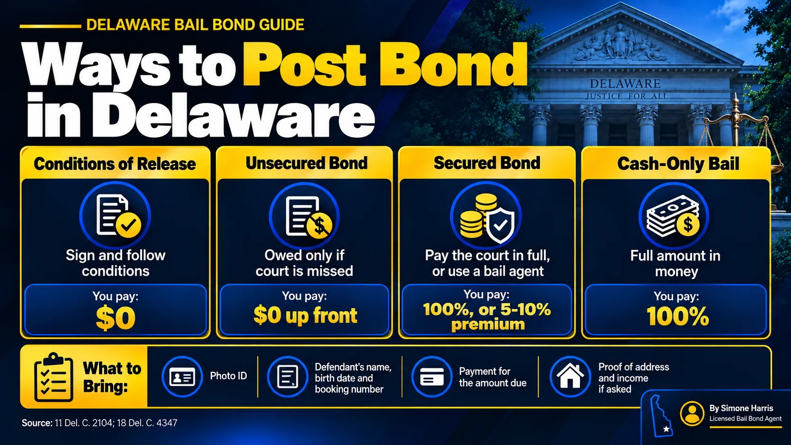

# How to Post Bond in Delaware: What It Means and How It Works

Posting bond means giving the court what it requires, money or a guarantee, so a person who was arrested can be released while their case goes on. Once the bond is posted and the paperwork clears, the person goes home and must follow the bond's conditions until the case ends.

In Delaware, how you post depends on the type of bond the judge set. Some bonds need no money at all. Others can be posted in full with the court or through a licensed bail agent for a percentage. Cash-only bail has to be paid in full. This guide walks through each route and what to have ready.

> To post bond means to provide the money or guarantee a court requires for release. In Delaware you can post a secured bond by paying the full amount to the court, or by hiring a licensed bail agent who posts it for a premium of 5% to 10%, with at least 5% paid before posting. Cash-only bail must be paid in full.

## What "Posting Bond" Actually Means

People use "post bail" and "post bond" for the same thing. The judge sets the bond: the type, any dollar amount and the conditions. Posting is the step where someone satisfies it. That can mean depositing money with the court, or having a bail agent file a surety bond that promises the full amount if the person doesn't come back.

For the terms, see [bail vs bond in Delaware](/blog/bail-vs-bond-delaware). For how the judge sets the bond in the first place, read [what a bond hearing is](/blog/what-is-a-bond-hearing).

## The Ways to Post Bond in Delaware

| Bond type set by the judge | How it's posted | What you pay |
|---|---|---|
| Conditions of release bond | The person signs and agrees to the conditions | Nothing |
| Unsecured bond | The person signs; money is owed only if court is missed | Nothing up front |
| Secured bond | Full amount to the court, or a surety bond through a bail agent | 100%, or a 5% to 10% premium |
| Cash-only bail | Full amount in money to the court, or a property bail agent | 100%, or a property agent's 20% to 30% charge |

### Posting the full amount with the court

If you can cover the whole bond, you can post it yourself. Call the court that set the bond first to ask which payment methods it accepts for bail, where to pay and who the money will be returned to. Money posted this way is generally returned after the case if every condition was met; see [do you get bail money back](/blog/do-you-get-bail-money-back). Our guide on [paying bail with a credit card](/blog/can-you-pay-bail-with-a-credit-card) covers card questions.

### Posting through a licensed bail agent

This is the most common route on larger secured bonds. Under [18 Del. C. § 4347](https://delcode.delaware.gov/title18/c043/sc02/index.html), the premium on a surety bond over $1,000 is 5% to 10%, and the agent must collect at least 5% and sign a written contract with you before posting. A Way to Freedom Bail Bonds charges 10%.

| Bond | Premium at 10% | Due before posting |
|---|---|---|
| $2,500 | $250 | $125 |
| $10,000 | $1,000 | $500 |
| $40,000 | $4,000 | $2,000 |

The premium isn't refunded, but you don't tie up the full amount. If you need time on the balance, ask about [bail bond payment plans](/blog/how-do-bail-bond-payment-plans-work).

### Cash-only bail

A surety bond can't be used on cash-only bail. The full amount has to be paid in money, or a property bail agent can post it for a charge of 20% to 30%. See [secured bail vs cash-only bail](/blog/secured-bail-vs-cash-only-bail-delaware) and [what a cash surety bond is](/blog/what-is-a-cash-surety-bond).

## Step by Step: Posting Bond Through a Bail Agent

1. Find out where the person is held, the charge, the bond type and the amount.
2. Call a licensed bail agent with those details.
3. Decide who will co-sign, and gather ID and proof of address and income.
4. Pay at least 5% of the bond and sign the written agreement.
5. The agent posts the bond with the court or facility.
6. Wait for processing and release, then make sure the person keeps every court date.

For the full walkthrough, see [how to bond someone out of jail in Delaware](/blog/how-to-bond-someone-out-of-jail-delaware). If it's late Friday, read [whether you can bail someone out on the weekend](/blog/can-you-bail-someone-out-of-jail-on-the-weekend).

## What to Bring

- Government photo ID for whoever is paying or co-signing
- The defendant's full name, date of birth and booking or case number
- Payment for the amount due
- Proof of address and income, if a bail agent asks
- Collateral documents, if the agent needs them on a large bond

## Posting an Immigration Bond Is Different

If the person is held by ICE rather than a Delaware court, the bond is federal. It's posted with ICE, usually online through CeBONDS, by a U.S. citizen, permanent resident, law firm or non-profit, and it's paid by bank transfer. Delaware bail agents and Delaware bail rules don't apply. See [how to pay an immigration bond](/blog/how-to-pay-immigration-bond) and [immigration bail bonds in Delaware](/blog/immigration-bail-bonds-delaware).

## Frequently Asked Questions

### What does it mean to post a bond?

It means providing the money or guarantee the court requires so a person can be released before trial. That can be the full amount paid to the court, or a surety bond filed by a bail agent.

### What does posting a bond mean for the defendant?

They can go home, but they must follow every condition of the bond and appear at every court date. Missing court can lead to a warrant and loss of the bond.

### How long does it take to post bond?

Paying or signing can take minutes. Release processing at the facility takes longer and varies by facility, time of day and how busy it is.

### Can anyone post bond for someone?

Generally, yes. A family member or friend can pay the court or work with a bail agent. Whoever co-signs with an agent takes on responsibility if the defendant misses court.

### Do you get money back after posting bond?

Money posted in full with the court is generally returned after the case if all conditions were met. A bail agent's premium isn't refunded.

### Can I post bond online in Delaware?

Ask the court that set the bond what it accepts. For immigration bonds, ICE uses its online CeBONDS system.

## Ready to Post Bond in Delaware?

Posting bond is the step that brings someone home, and getting it right the first time saves hours. A Way to Freedom Bail Bonds can confirm the bond type and amount, explain the 10% premium and the 5% due before posting, and post the bond any time, day or night. [Contact us](/contact). This article is general information about Delaware bail, not legal advice.
