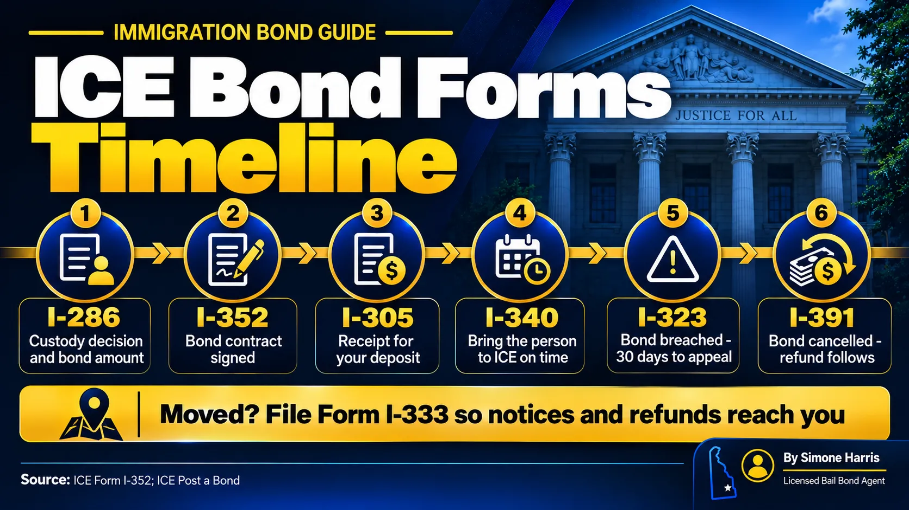

# ICE Bond Forms Explained: I-286, I-352 and the Notices That Follow

Immigration bonds come with a trail of paperwork, and each form number means something specific. Form I-286 is ICE's notice of whether a detained person can be released and on what bond. Form I-352 is the bond contract the obligor signs. After that, ICE communicates through notices: a demand to bring the person in, a breach notice, or a cancellation notice that starts the refund.

Families often call any of these "the bond letter." Knowing which one you're holding tells you what to do next, and sometimes how much time you have. This guide goes through each ICE bond form in the order you're likely to see it.

> Form I-286, Notice of Custody Determination, is ICE's decision on whether to detain, release or set a bond. Form I-352 is the immigration bond contract. After posting, ICE may send Form I-340 (demand to deliver the person), Form I-323 (bond breached, 30 days to appeal) or Form I-391 (bond cancelled, refund follows). Form I-333 updates the obligor's address.

## The Forms at a Glance

| Form | Name | Who gets it | What to do |
|---|---|---|---|
| I-286 | Notice of Custody Determination | The detained person | Read the decision; ask an attorney about requesting a bond hearing |
| I-352 | Immigration Bond | Signed by the obligor (and any surety agent) | Read every term before signing; keep a copy |
| I-305 | Receipt for the bond deposit | The obligor | Keep the original with the I-352 |
| I-340 | Notice to Obligor to Deliver Alien | The obligor | Make sure the person reports exactly when and where stated |
| I-333 | Obligor Change of Address | Filed by the obligor | Submit as soon as you move |
| I-323 | Notice – Immigration Bond Breached | The obligor | Act within 30 days if you want to contest it |
| I-391 | Notice – Immigration Bond Cancelled | The obligor | Keep it; the refund goes to the address on file |

## Form I-286: Notice of Custody Determination

This is usually the first bond document, issued by ICE soon after detention. It records ICE's custody decision: keep the person detained, release them on their own recognizance or other conditions, or release them once a bond in a stated amount is posted. It also gives the person a way to ask an immigration judge to review that decision.

If the I-286 sets a bond the family can afford, it can be posted with ICE right away. If it denies bond or sets an amount that's too high, an immigration attorney can request a bond redetermination hearing, if the person is eligible. Eligibility has changed since 2025, so see our guide to the [immigration bond hearing](/blog/immigration-bond-hearing).

## Form I-352: The Immigration Bond Contract

The I-352 is the actual bond. It's a contract between the obligor and ICE, and its own instructions say its express language controls over any other statements. Key terms from the current form include:

- The obligor guarantees the person will meet their obligations, secured by the bond amount.
- A cash obligor deposits the full amount, which ICE holds through the Treasury. The obligor's taxpayer ID is used to pay and report interest.
- A surety company must be on Treasury Circular 570, and its agent signs as a co-obligor, jointly liable for any breach.
- The obligor must report any address change on Form I-333.
- If the bond is cancelled with an I-391, ICE refunds the cash deposit and interest to the obligor at the address on file.

The form also lists what cancels a delivery bond, such as a grant of permanent residence, termination of proceedings, or departure under a grant of voluntary departure. Administrative closure doesn't. Our guide to [immigration bond refunds](/blog/immigration-bond-refund) covers that list.

Today most I-352s are signed electronically through CeBONDS; see [how to pay an immigration bond](/blog/how-to-pay-immigration-bond).

## Form I-340: Notice to Deliver

On a delivery bond, ICE can send an I-340 telling the obligor to produce the person at a set place, date and time. This is the notice that matters most. ICE has said that even arriving a day late can, depending on the circumstances, count as failing to perform, which can lead to a breach.

If you get an I-340, call the person and their attorney the same day. Plan the trip early and keep proof that they appeared.

## Form I-323: Bond Breached

If ICE decides the bond terms weren't met, it sends an I-323. Under the I-352, the obligor has 30 days to file an administrative appeal or motion to reconsider. If nothing is filed, the breach becomes final and the cash deposit is forfeited, though ICE still refunds the interest it earned. Talk to an attorney quickly if you receive one.

## Form I-391: Bond Cancelled

This is the good one. An I-391 means the bond is over and, for a cash bond, the deposit and interest will be refunded to the obligor at the address ICE has on file. Keep it with the I-352 and I-305. If the refund doesn't arrive, ICE directs obligors to its Financial Service Center in Burlington.

## Other Forms You May See

- Form I-220A, Order of Release on Recognizance, if the person is released without a bond
- Form I-220B, Order of Supervision, which lists reporting conditions for some released people
- Form I-862, Notice to Appear, which starts the removal case in immigration court

## Frequently Asked Questions

### What is a bond letter from ICE?

People use "bond letter" for different documents. Most often it means the I-286 Notice of Custody Determination, which states whether a bond was set and the amount, or a notice ICE sends the obligor after the bond is posted.

### What is Form I-286?

It's ICE's Notice of Custody Determination. It says whether the person will stay detained, be released on conditions, or be released once a bond is posted, and it lets them ask for review by an immigration judge.

### What is Form I-352?

It's the immigration bond contract between the obligor and ICE. It sets out the obligor's duties, when the bond is cancelled or breached, and how the deposit is refunded.

### What should I do if I get a Form I-340?

Make sure the person reports at the exact place, date and time listed. Missing it, or even arriving late, can lead to a breach.

### How long do I have to appeal a bond breach?

The I-352 says the obligor has 30 days after the breach notice to file an administrative appeal or a motion to reconsider.

### Where do I send a change of address for an immigration bond?

Submit Form I-333 to the ICE Enforcement and Removal Operations office where you posted the bond, or follow the instructions in your CeBONDS account.

## Keep Every Form in One Place

Immigration bond paperwork follows the family for years, and a lost notice can cost the whole deposit. Keep the I-286, I-352, I-305 and every notice together, and share copies with the attorney. If you're also dealing with a Delaware criminal case, A Way to Freedom Bail Bonds can explain the state bail side. [Contact us](/contact). For the basics, see [what is an immigration bond](/blog/immigration-bonds-delaware). This article is general information, not legal advice.
