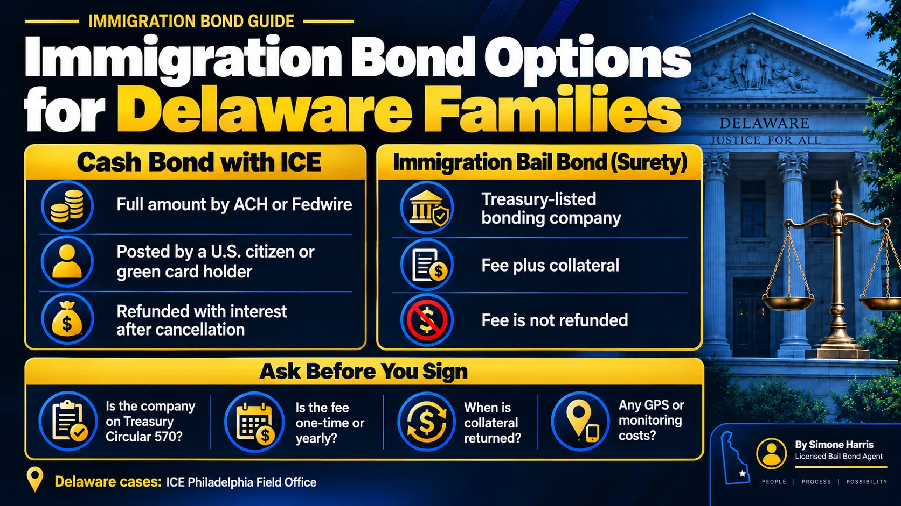

# Immigration Bail Bonds in Delaware: What Families Should Ask First

An immigration bail bond is a surety bond posted with ICE by a bonding company so a detained person can be released while their immigration case continues. The family pays the company a fee and usually puts up collateral, and the company guarantees the full bond to the government. It's the immigration version of using a bail agent, but it runs under federal rules, not Delaware's bail laws.

For families in Delaware, the case is handled by ICE's Philadelphia Field Office, which covers Delaware, Pennsylvania and West Virginia. The person may be held outside the state. This guide explains when an immigration bail bond makes sense, what it costs, and what to ask before you sign anything.

> An immigration bail bond is a surety bond posted with ICE by a Treasury-certified bonding company. The family pays a non-refundable fee and often collateral, and the company guarantees the full bond. It's an alternative to paying the full amount in cash through ICE's CeBONDS system. Delaware cases fall under ICE's Philadelphia Field Office.

## Cash Bond or Immigration Bail Bond?

Once ICE or an immigration judge sets a bond, there are two ways to post it.

| | Cash bond through ICE | Immigration bail bond (surety) |
|---|---|---|
| Who posts it | An eligible obligor: U.S. citizen, permanent resident, law firm or non-profit | A surety company and its agent |
| What the family pays | The full bond amount, by ACH or Fedwire | A fee plus any collateral the company asks for |
| Refundable | Yes, with interest, after ICE cancels the bond | The fee isn't |
| Best for | Families who can move the full amount | Large bonds, or no eligible obligor with a bank account |

ICE itself points families without banking access to surety companies on the Treasury Department's list. Our guide on [how to pay an immigration bond](/blog/how-to-pay-immigration-bond) covers the cash route step by step.

## How an Immigration Bail Bond Works

1. ICE or an immigration judge sets the bond amount. See [immigration bond hearings](/blog/immigration-bond-hearing) for how that happens.
2. The family contacts a bonding company and gives it the person's name, A-number and bond amount.
3. The company reviews the case, sets its fee and asks for collateral and an indemnity agreement.
4. The company's agent posts the bond with ICE on Form I-352, with a power of attorney from the surety.
5. ICE processes the bond during posting hours, and the person is released.
6. The family keeps every check-in and hearing until ICE cancels the bond.

Under the terms of Form I-352, a surety company must appear on the Treasury Department's Circular 570 list, and its agent signs as a co-obligor who is jointly liable with the company. If the bond is breached, the government collects from the surety, and the surety will look to the family's agreement and collateral.

## What It Costs

Delaware's premium rules in 18 Del. C. § 4347 apply to bail bonds in Delaware's own courts. For federal immigration bonds, the fee is set by the bonding company and its agreement, so it varies. Ask for the full cost in writing, including:

- The fee as a percentage of the bond, and whether it's charged once or every year the bond stays open
- Any application, processing or monitoring charges
- Whether GPS monitoring or check-in services are required, and what they cost each month
- What collateral is required and how it's held and returned

Immigration cases can run for years, so an annual fee can add up to far more than the first payment. Compare that against the cash route, where the full deposit comes back with interest once ICE cancels the bond; see [immigration bond refunds](/blog/immigration-bond-refund).

## Questions to Ask Before You Sign

- Is the surety on the current Treasury Circular 570 list? Ask for the company name and check it.
- Who is the agent signing the I-352, and do they have a power of attorney from the surety?
- Is the fee one-time or recurring?
- What collateral do you require, and when exactly is it returned?
- Are there monitoring requirements on top of ICE's own conditions?
- What happens if a check-in is missed or ICE sends a notice to deliver?
- Will I get copies of the I-352 and every notice ICE sends about the bond?

Be wary of anyone who promises guaranteed release, says they can make a bond hearing happen, or asks for payment by gift card or crypto. Only ICE and immigration judges decide on release and bond.

## Delaware-Specific Points

- ICE's Philadelphia Field Office handles Delaware, with a check-in location in Dover. A detained person may still be held in another state.
- An immigration bond and a Delaware criminal bail bond are separate. If a loved one has both a state charge and an ICE detainer, posting state bail may lead to transfer to ICE custody rather than release home. Ask a defense attorney and an immigration attorney before posting.
- Delaware-licensed bail agents work under 18 Del. C. ch. 43 for state courts. For federal immigration bonds, look for a company on the Treasury list.

For Delaware criminal bail, see [how bail bonds work in Delaware](/blog/how-bail-bonds-work-in-delaware).

## Frequently Asked Questions

### What is an immigration bail bond?

It's a surety bond posted with ICE by a Treasury-certified bonding company so a detained person can be released. The family pays the company a fee and often provides collateral.

### How much does an immigration bail bond cost?

It depends on the company. Fees are set by the company's agreement, and some charge every year the bond stays open. Ask for every charge in writing before signing.

### Is an immigration bail bond refundable?

The company's fee isn't. Collateral should be returned after ICE cancels the bond, under the terms of your agreement. A cash bond posted directly with ICE is refunded with interest after cancellation.

### Who handles immigration bonds for Delaware?

ICE's Philadelphia Field Office covers Delaware, Pennsylvania and West Virginia. Bonds are usually posted online through CeBONDS or through a surety company.

### Can a Delaware bail bondsman post an immigration bond?

Only if they're an agent for a surety company that's certified for federal bonds and has authority to post immigration bonds with ICE. Ask directly.

### Do I need a lawyer for an immigration bond?

You don't need one to pay a bond, but an immigration attorney is essential for the bond hearing and the case itself.

## Talk Through Your Options

When a family member is in ICE custody, every choice feels urgent. A Way to Freedom Bail Bonds can help Delaware families understand the difference between state bail and immigration bonds, and the questions to ask before paying anyone. [Contact us](/contact). For the basics, read our guide [what is an immigration bond](/blog/immigration-bonds-delaware). This article is general information, not legal advice.
