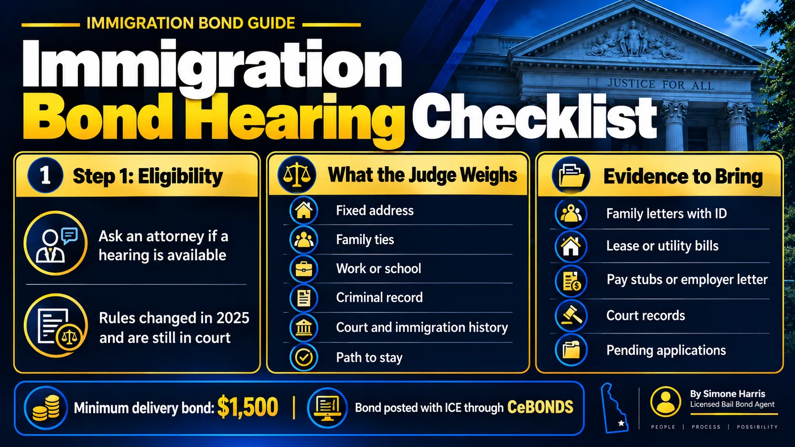

# Immigration Bond Hearing: What Happens and How to Prepare

An immigration bond hearing, sometimes called a custody redetermination hearing, is where an immigration judge decides whether a person held by ICE can be released while their immigration case continues, and how much bond they must post. It's separate from the main removal case. The judge isn't deciding whether the person can stay in the United States, only whether they can wait at home instead of in detention.

These hearings are short, and the outcome depends heavily on preparation. They've also become harder to get. Since 2025, decisions from the Board of Immigration Appeals and federal courts have changed who is eligible, and the rules are still being fought over. This guide explains how the hearing works and what a family can do to help.

> An immigration bond hearing is a separate proceeding where an immigration judge decides whether a detained noncitizen can be released and sets the bond, at least $1,500 by statute. The detained person generally must show they aren't a danger and are likely to appear. Eligibility for a hearing changed in 2025 and is still being litigated, so an immigration attorney should confirm it first.

## How It Differs From a Criminal Bond Hearing

| | Delaware criminal bond hearing | Immigration bond hearing |
|---|---|---|
| Who decides | A Delaware judicial officer | A federal immigration judge |
| What law applies | 11 Del. C. ch. 21 | Federal immigration law and regulations |
| Bail agents | Delaware-licensed bail agents | Treasury-certified surety companies, or cash with ICE |
| Minimum amount | None set by statute | $1,500 |
| How bond is paid | To the court, or through a bail agent | To ICE, usually online through CeBONDS |

If a loved one has both a state criminal case and an ICE hold, they're two separate processes. Our guide to [what a bond hearing is in Delaware](/blog/what-is-a-bond-hearing) covers the state side.

## Who Can Get an Immigration Bond Hearing

Under federal law, ICE can release some detained people on a bond of at least $1,500, and an immigration judge can review ICE's custody decision. But not everyone qualifies. People held under mandatory detention rules, such as many with certain criminal convictions, and people treated as "arriving" at the border, have generally been unable to get bond from an immigration judge.

That group grew in 2025. In *Matter of Yajure Hurtado*, 29 I&N Dec. 216 (BIA 2025), the Board of Immigration Appeals held that immigration judges have no authority to grant bond to people who entered without inspection, no matter how long they've lived here. In February 2026, a federal district court vacated that decision, but the government appealed and the ruling's effect has been paused while the appeal continues. As of this writing, whether a particular person can get a hearing depends on how they entered, where they're detained and the current state of that litigation.

This is the first thing an immigration attorney should check. Don't assume a hearing is or isn't available based on a friend's case.

## How to Request the Hearing

The detained person, or their attorney, asks the immigration court for a bond redetermination. The request can be made in writing, or orally in some situations. Federal regulations keep the bond record separate from the removal case, so what's said at the bond hearing doesn't automatically become part of the removal record.

Which immigration court hears it depends on where the person is detained, not where they lived. For someone from Delaware, that may be a court in another state, and the hearing may happen by video.

## What the Judge Considers

The detained person generally has to show they aren't a danger to the community and that they're likely to show up for future hearings. Under long-standing Board decisions such as *Matter of Guerra* (2006), judges look at factors like:

- Whether the person has a fixed address in the United States
- How long they've lived here
- Family ties, especially U.S. citizen or permanent resident relatives
- A steady job or school enrollment
- Criminal record, if any, and how recent and serious it is
- History of immigration violations or missed court dates
- Whether they have a realistic path to stay, such as a pending application
- Any history of fleeing prosecution

If the judge grants bond, they set the amount. If the amount is more than the family can pay, the attorney can ask for a lower figure at the hearing or seek review.

## Evidence Families Can Gather

The judge decides on what's in front of them, so documents matter more than speeches. Useful evidence includes:

1. Letters from family members with proof of their citizenship or residence
2. A lease, mortgage or utility bills showing a stable address
3. Pay stubs, an employer letter or tax returns
4. Proof of community ties: church, school, volunteer work
5. Proof of any pending immigration application
6. Certified court records showing how any criminal case ended
7. A letter from the person who will be the bond obligor

Gather these early and give them to the attorney, who decides what to submit. Letters should be signed, dated and include the writer's contact information.

## After the Hearing

If the judge sets a bond, someone eligible must post it with ICE, usually online through CeBONDS. Our guide on [how to pay an immigration bond](/blog/how-to-pay-immigration-bond) walks through the steps, and [immigration bond refunds](/blog/immigration-bond-refund) explains when the money comes back.

If bond is denied or set too high, either side can appeal to the Board of Immigration Appeals. ICE can also seek to keep the person in custody while it appeals a bond the judge granted, so release isn't always immediate. In some cases, the person can ask for a new hearing if their circumstances change significantly.

## Frequently Asked Questions

### What is an immigration bond hearing?

It's a hearing where an immigration judge decides whether a person held by ICE can be released during their case and sets the bond amount. It's separate from the hearing that decides whether the person can stay in the country.

### What is the minimum immigration bond?

Federal law sets the minimum delivery bond at $1,500. Judges often set higher amounts depending on the case.

### Can everyone in ICE detention get a bond hearing?

No. People under mandatory detention rules and people classed as arriving at the border generally can't. A 2025 BIA decision extended that to people who entered without inspection, and that decision is still being challenged in federal court, so check with an immigration attorney.

### How long does an immigration bond hearing take?

The hearing itself is often short, sometimes 15 minutes or less. Getting it scheduled can take longer, depending on the court.

### Can family members testify at a bond hearing?

Sometimes, but written evidence usually matters more. The attorney will decide whether live testimony would help.

### Can a bond amount be lowered after the hearing?

The person can appeal to the Board of Immigration Appeals, or ask for a new hearing if circumstances have materially changed since the first one.

## Questions About Bonds?

Immigration bond hearings follow federal rules and change quickly, so the first call should be to an immigration attorney. If your family is also dealing with a Delaware criminal case, A Way to Freedom Bail Bonds can explain the state bail side and how it differs. [Contact us](/contact). For the basics, see our guide [what is an immigration bond](/blog/immigration-bonds-delaware). This article is general information, not legal advice.
