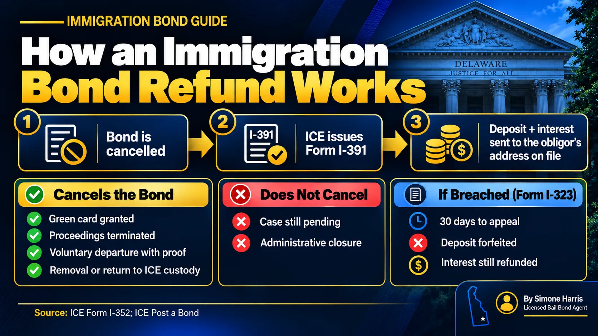

# Immigration Bond Refund: How to Get Your ICE Bond Money Back

Yes, a cash immigration bond is refundable. When ICE cancels the bond, it refunds the cash deposit plus interest to the person who posted it, called the obligor. The catch is that cancellation only happens after certain events, and a pending case, even one that's been paused for years, usually doesn't count.

The refund also goes to the obligor, at the address ICE has on file. If that address is out of date, the money can end up lost in the mail. This guide covers what triggers a refund, what can stop one, and what to do if yours hasn't arrived.

> An immigration bond is refunded after ICE cancels it and issues Form I-391, Notice – Immigration Bond Cancelled. ICE then sends the cash deposit plus interest to the obligor at the address on file. If ICE declares a breach on Form I-323, the deposit is forfeited, though the interest is still refunded. A surety company's premium is never refunded.

## Who Gets the Refund

The money goes back to the obligor, the person or organization that posted the cash bond. It doesn't go to the person who was released, and it doesn't go to whoever gave the obligor the money. If several relatives chipped in, they'll need to sort that out with the obligor once the refund arrives.

Two details on the bond contract matter here. ICE's Form I-352 asks for the obligor's taxpayer identification number, because ICE pays and reports interest through the Treasury. And it requires the obligor to report any change of address on Form I-333.

## When an Immigration Bond Is Cancelled

Under the terms of Form I-352, a delivery bond is cancelled if one of these happens before any breach:

| Event | Bond cancelled? |
|---|---|
| The person is granted permanent residence | Yes |
| Removal proceedings are terminated | Yes |
| The person leaves under a grant of voluntary departure, with valid proof | Yes |
| ICE takes the person back into custody | Yes |
| The person is removed from the United States | Yes |
| The person dies | Yes |
| The case is administratively closed or stayed | No |
| The case is still pending in immigration court | No |

The last two rows surprise people. A bond can stay open, and the money tied up, for as long as the case is open. If the case is administratively closed, the bond isn't cancelled on that basis.

## How the Refund Process Works

1. An event that cancels the bond happens.
2. ICE issues Form I-391, Notice – Immigration Bond Cancelled.
3. ICE refunds the cash deposit and the interest to the obligor at the address on file.

ICE's I-352 describes the refund as going to the obligor's address of record, so there's no separate application on that form. Many legal aid groups still recommend keeping the original bond receipt (Form I-305) and the I-391 together, since they make it much easier to sort out a missing or delayed payment.

If you posted through CeBONDS, check your account for notices. ICE sends bond documents there too. Our guide on [how to pay an immigration bond](/blog/how-to-pay-immigration-bond) explains the CeBONDS account.

## What Can Stop a Refund: Breach

If the obligor doesn't produce the person when ICE demands it, ICE can declare the bond breached. It sends Form I-323, Notice – Immigration Bond Breached. The obligor has 30 days to file an administrative appeal or a motion to reconsider. If nobody acts in time, the breach becomes final.

When a cash bond is breached, the deposit is forfeited to the government. ICE says it still refunds the interest that built up on the deposit.

A few rules from the I-352 help obligors:

- A delivery bond can't be breached if, on the date the person had to be produced, they were in local, state or federal custody, or outside the United States.
- Notice to either the obligor or a co-obligor counts, so an old address is no excuse.
- ICE has said that even showing up one day late can, depending on the circumstances, be treated as failing to perform.

Read every notice the day it arrives, and if you get a Form I-340 demand to deliver, make sure the person reports on time.

## Cash Bond vs Surety: What's Refundable

| | Cash bond posted with ICE | Bond through a surety company |
|---|---|---|
| Who paid ICE | You, the obligor | The surety company |
| Refund after cancellation | Deposit plus interest | The company's obligation ends; your premium isn't returned |
| Collateral | None with ICE | Returned by the company under its agreement once the bond is cancelled |

If you used a surety company, ask it how it handles collateral after cancellation. Our [immigration bonds guide](/blog/immigration-bonds-delaware) explains both routes.

## If Your Refund Hasn't Arrived

- If the bond is still open, contact the nearest ICE field office.
- If you got a cancellation or breach notice and have a refund question, ICE directs obligors to the Financial Service Center in Burlington: BondRefund.HelpDesk@ice.dhs.gov or 877-491-6521, option 1.
- If you've moved, file Form I-333 with the ICE office where the bond was posted.
- Keep copies of the I-352, the I-305 receipt, any I-391 and your ID.

An immigration attorney or a legal aid group that handles bond refunds can help if the money is stuck.

## Frequently Asked Questions

### Are immigration bonds refunded?

Cash bonds posted with ICE are refunded, with interest, after ICE cancels the bond. If the bond is breached, the deposit is forfeited, but ICE still refunds the interest.

### How can I get my bond money back from immigration?

Wait for the bond to be cancelled. ICE issues Form I-391 and sends the deposit plus interest to the obligor at the address on file, so keep your address current with Form I-333.

### How long does an immigration bond refund take?

ICE doesn't publish a set timeline. The bigger delay is usually the case itself, since the bond isn't cancelled until an event like a grant of residence, termination of proceedings, or departure under voluntary departure.

### Does winning the case mean I get the bond back?

If the person is granted permanent residence or the proceedings are terminated, the bond is cancelled and the refund follows. Other outcomes depend on what happens next, so ask the attorney.

### Who receives the immigration bond refund?

The obligor who posted the cash bond, at the address ICE has on file.

### Does ICE ask for bond money by phone?

ICE bond payments go through CeBONDS or an ICE office, by bank transfer. Be wary of anyone who calls asking for money to release a detainee or to release a refund, and confirm directly with ICE.

## Questions About Bond Money?

Immigration bond refunds follow federal rules, and they work differently from Delaware bail. If you're unsure where money posted for a loved one stands, A Way to Freedom Bail Bonds can help Delaware families understand the difference between a state bail refund and an immigration bond refund. [Contact us](/contact). For Delaware bail, see [do you get bail money back](/blog/do-you-get-bail-money-back). This article is general information, not legal advice.
