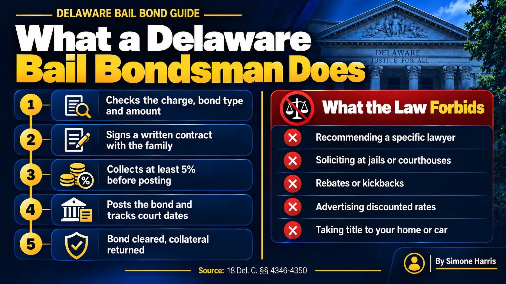

# What Does a Bail Bondsman Do? Duties and Limits in Delaware

A bail bondsman guarantees the full bail amount to the court so a person who was arrested can go home while the case moves forward. The family pays the bondsman a premium, signs an agreement, and the bondsman posts a bond that promises the court the full amount if the person doesn't come back. If the person makes every court date, the bond is cleared and the job is done.

In Delaware, the legal term is "bail agent," and the work is regulated by the Department of Insurance under [18 Del. C. ch. 43, subchapter II](https://delcode.delaware.gov/title18/c043/sc02/index.html). That law sets what an agent can charge, how collateral must be handled, and a list of things an agent is never allowed to do. This guide explains the job from start to finish and where the limits are.

> A bail bondsman, called a bail agent in Delaware, posts a bond that guarantees the full bail to the court, in exchange for a premium of 5% to 10% on surety bonds over $1,000. The agent checks the case, signs a written contract with the family, posts the bond, holds any collateral in trust, and tracks the defendant until the case ends.

## What a Bail Bondsman Does, Step by Step

1. The agent confirms where the person is held, the charge, the bond type and the amount. A surety agent can post a secured bond, but not cash-only bail.
2. The agent asks about the defendant's ties to the area, work, past court record and who will co-sign.
3. The agent explains the cost. Delaware requires a written contract with all the terms, signed before the bond is posted.
4. You pay at least 5% of the bond before posting.
5. The agent files the bond with the court or the facility, and the release process starts.
6. During the case, agents typically send court date reminders and keep contact details current.
7. When the case ends and the court exonerates the bond, the guarantee ends and any collateral is returned.

For the full release process from the family's side, see the [bail bond process step by step](/blog/bail-bond-process-step-by-step).

## How a Bondsman Gets Paid

The bondsman earns the premium. Under [18 Del. C. § 4347](https://delcode.delaware.gov/title18/c043/sc02/index.html), the total filed premium on a surety bond over $1,000 must be between 5% and 10%, and the agent can't charge extra administrative or service fees that weren't filed and approved. A Way to Freedom Bail Bonds charges 10%, with at least 5% due before posting.

| Bond amount | Premium at 10% | Due before posting |
|---|---|---|
| $5,000 | $500 | $250 |
| $20,000 | $2,000 | $1,000 |
| $50,000 | $5,000 | $2,500 |

The premium isn't returned after the case, because it pays for the guarantee. If you want the business side in detail, read [how a bail bond makes money](/blog/how-does-a-bail-bond-make-money). For the percentages by bond type, see [what percentage of bail you pay](/blog/what-percentage-of-bail-do-you-pay).

## Collateral: Held in Trust

On bigger bonds, the agent may ask for collateral, such as cash, a car title lien or a lien on real estate. Delaware's rules in § 4348 are specific:

- Collateral must be reasonable compared with the bond amount.
- The agent holds it as a fiduciary and must keep it separate from the agent's own money.
- The agent can't require you to transfer the title to your house or car. A lien is allowed; taking ownership isn't.
- Once the bond is discharged and fees are paid, the collateral must be returned promptly on request.

## What Happens If the Defendant Misses Court

This is where the bondsman's guarantee matters. If the defendant misses court, the court can issue a capias and move toward forfeiting the bond. Under § 4349, an agent who knows where the defendant is must notify the nearest law enforcement agency. The agent may also hire a licensed bail enforcement agent, and the costs can be charged to the co-signer.

The fastest fix is usually to get the person back in front of the court. Our guide on [bail for a bench warrant](/blog/how-much-is-bail-for-a-bench-warrant) explains what happens next, and the co-signer's role is covered in [how bail bonds work in Delaware](/blog/how-bail-bonds-work-in-delaware).

## What a Bail Bondsman Can't Do in Delaware

Delaware's § 4350 lists things a bail agent is never allowed to do. An agent can't:

- Recommend or name a particular attorney for the defendant
- Solicit business at a jail, prison or courthouse
- Give the defendant or family a rebate, kickback or anything of value to win the business
- Pay anyone to get a bail amount reduced
- Advertise "discounted" rates, use a misleading name, or imply a connection to a government agency
- Act as the defendant's lawyer at a hearing

The law also bars some people from being bail agents at all, including police officers, jailers, judges and court clerks, sheriffs and constables, and attorneys and their staff.

Agents must keep a public place of business in Delaware and display their licenses and fees there (§ 4346). Advertising has to show the agent's registered name and license number. Those details are worth checking before you sign anything; see [common mistakes when posting bail in Delaware](/blog/common-mistakes-to-avoid-when-posting-bail-in-delaware).

## Why Families Use a Bail Bondsman

The main reason is money. Paying a $20,000 bail in full ties up $20,000 until the case ends, which can take months. With an agent, the family pays the premium and keeps the rest of its savings. An agent also knows how the local courts and facilities work, which helps at 2 a.m. when nobody else is answering. And when the premium is hard to pay at once, many agencies offer [bail bond payment plans](/blog/how-do-bail-bond-payment-plans-work).

A bondsman isn't always needed. If the judge sets a conditions of release bond or an unsecured bond, nobody has to pay anything to get out; see [what is unsecured bail](/blog/what-is-unsecured-bail-delaware).

## Frequently Asked Questions

### Why would someone use a bail bondsman?

To get a loved one released without paying the full bail amount. The family pays a premium, 5% to 10% in Delaware, and the bondsman guarantees the rest to the court.

### How much is 10% of a $50,000 bond?

$5,000. In Delaware, at least 5% of the bond, or $2,500, must be paid before the agent posts it. The agent may also ask for collateral on a bond that size.

### How does a bail bondsman actually make money?

From the premium. On most bonds, the defendant shows up to court, the bond is cleared, and the agent keeps the premium as its fee for taking on the risk.

### What powers does a bail bondsman have?

A bail agent can post bonds, set the terms of its contract within the law, hold collateral and, if a defendant misses court, work to return the person to custody, including through a licensed bail enforcement agent. Its fees and conduct are limited by 18 Del. C. ch. 43.

### Is a bail bondsman the same as a bounty hunter?

No. In Delaware, the bail agent writes and posts the bond. A bail enforcement agent is a separately licensed person the agent may hire to find a defendant who missed court.

### How do I check that a bail bondsman is licensed in Delaware?

Ask for the agent's license number, which Delaware requires in advertising, and confirm it with the Delaware Department of Insurance.

## Talk to a Delaware Bail Agent

A good bail agent explains every number before you sign and tells you exactly what's expected until the case ends. A Way to Freedom Bail Bonds can confirm the bond type and amount, walk you through the 10% premium and the 5% due before posting, and post the bond any time, day or night. [Contact us](/contact), or learn more about our [Delaware bail bond company](/blog/bail-bond-company-delaware). This article is general information about Delaware bail, not legal advice.
