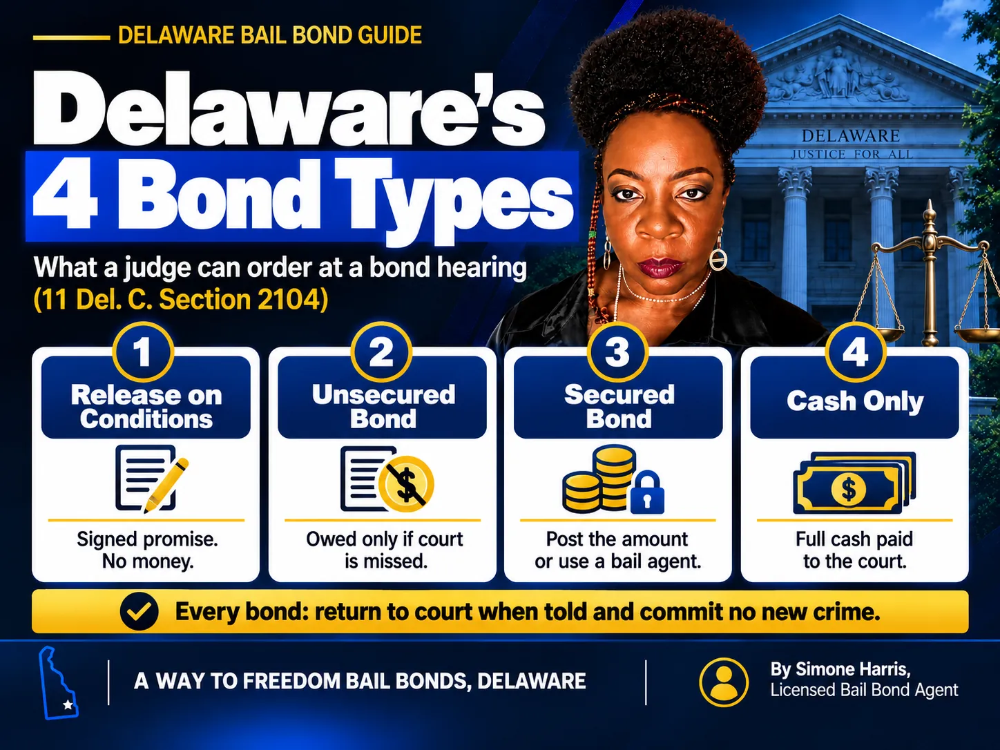

# What Is a Bond Hearing? How Bail Is Decided in Delaware

A bond hearing is a short court proceeding where a judicial officer decides whether a person who was arrested can be released before trial, and on what terms. It is not a trial. Nobody decides guilt or innocence. The only questions are whether the person is likely to come back to court and whether releasing them puts anyone at risk.

In Delaware, the first bond decision usually happens soon after an arrest, often in front of a Justice of the Peace Court magistrate. That decision sets the type of bond, any dollar amount and the conditions the person must follow. This guide walks through what the judge can order, what they look at, what happens in the room, and how to ask for a change if the bond is out of reach.

> A bond hearing is where a judge decides if a defendant can be released before trial and on what conditions. In Delaware, the judge chooses between four types of conditions of release bond and weighs factors set out in 11 Del. C. § 2105, such as the charge, ties to the community and court history.

## What Is a Bond Hearing?

People use "bond hearing" and "bail hearing" for the same thing. The judge has the charging papers, the person's record and whatever the prosecutor and defense say, and decides how to secure the person's return to court.

The outcome is a bond order. It says whether the person can go home, how much money (if any) must be posted, what kind of security is accepted, and what conditions apply, like a no-contact order or a curfew. If you want the vocabulary straight first, read [bail vs bond in Delaware](/blog/bail-vs-bond-delaware).

## When the First Bond Hearing Happens in Delaware

Court rules require the arresting officer to bring the person before a committing magistrate **without reasonable delay**. That's the wording in Rule 5 of the Court of Common Pleas criminal rules. In practice, the first appearance is usually at a Justice of the Peace Court, several of which operate late into the night or around the clock.

Timing still varies with how busy the court is, the time of the arrest and whether the case needs a higher court. If the arrest happened late on a Friday, our guide on [whether you can bail someone out on the weekend](/blog/can-you-bail-someone-out-of-jail-on-the-weekend) explains what usually happens next.

## What the Judge Can Order: Delaware's Four Bond Types

Under [11 Del. C. § 2104](https://delcode.delaware.gov/title11/c021/index.html), a person charged with any crime other than a capital crime is released on one of four kinds of conditions of release bond:

| Bond type in § 2104 | What it means in plain English | Money needed to get out |
|---|---|---|
| Conditions of release bond | Release on a signed promise and conditions | None |
| Not guaranteed by financial terms | Unsecured: an amount is owed only if the person misses court | None up front |
| Guaranteed by financial terms | Secured: the amount must be posted, and the court decides what kind of surety it accepts | The bond amount, or a bail agent's premium |
| Secured by cash only | Cash only: money must be paid to the court | The full cash amount |

Every bond also comes with two required conditions: the person must come back to court when told to, and must not commit a new crime. The judge can add more. Delaware's law also says courts should use reasonable non-monetary conditions when those are enough, which is why many people are released without paying anything. The money-based options are explained in [what is unsecured bail](/blog/what-is-unsecured-bail-delaware) and [secured bail vs cash-only bail](/blog/secured-bail-vs-cash-only-bail-delaware).

## What the Judge Considers

Section 2105 (the version in effect as of October 2026) lists what the court must take into account when deciding whether someone is likely to appear and whether release is safe. The list includes:

- The nature and circumstances of the charge, and whether a firearm was used or possessed
- Whether the charge carries mandatory prison time
- Family ties, employment, financial resources, character and mental condition
- How long the person has lived in the community
- Their record of convictions and habitual offender eligibility
- Whether they were already on release or in custody when the offense happened
- Their history of following release terms, appearing in court, or failing to appear

If the judge decides unsecured release isn't enough, the law requires a record of the reasons and allows release once satisfactory surety is posted.

## What Happens at the Hearing, Step by Step

1. The person appears in front of the judicial officer, in person or by video.
2. The charges and the probable cause behind them are reviewed.
3. The prosecutor may argue for higher bail or stricter conditions.
4. The defense, or the person, can point to ties to the community, work and a clean court record.
5. The judge sets the bond type, any amount and the conditions.
6. The person is released, or held until the bond is posted.

These hearings are usually short. A few minutes is common.

## How to Prepare

If you're a family member, the most useful thing you can do is gather facts that line up with the § 2105 factors:

- Proof of a steady job or school enrollment
- Proof of address and how long the person has lived there
- Names of family members who can confirm local ties
- Any medical issues or care responsibilities the judge should know about

A defense attorney can present this far better than anyone else, and can tell you whether to speak at the hearing at all.

## After the Hearing: Posting the Bond

If the judge sets a secured bond, a licensed bail agent can post it for a premium. Under [18 Del. C. § 4347](https://delcode.delaware.gov/title18/c043/sc02/index.html), the total premium on a surety bond over $1,000 is between 5% and 10%, with at least 5% paid before posting. A Way to Freedom Bail Bonds charges 10%.

| Bond set at the hearing | Total premium (10%) | Due before posting (5%) |
|---|---|---|
| $2,500 | $250 | $125 |
| $10,000 | $1,000 | $500 |
| $50,000 | $5,000 | $2,500 |

If paying the premium at once is hard, ask about [bail bond payment plans](/blog/how-do-bail-bond-payment-plans-work). When the order allows either cash or a surety, our guide to [what a cash surety bond is](/blog/what-is-a-cash-surety-bond) compares the two routes. For the release process itself, see [how to bond someone out of jail in Delaware](/blog/how-to-bond-someone-out-of-jail-delaware).

## Asking for a Bond Review or Modification

A bond set at the first appearance isn't always the last word. A defense attorney can file a motion to modify bond to ask the court to lower the amount, change the type or adjust conditions. The Court of Common Pleas bail page notes that a Motion to Modify Bond is the route to change bond conditions or amounts.

Bail can also go up. Under the version of § 2116 in effect until February 1, 2027, if someone out on bail for a violent felony is charged with a new violent felony, the original bail is temporarily revoked until the Superior Court holds a hearing. If the court revokes it, the new bail is at least twice the original and can be set as cash only.

Delaware's updated bail law takes effect on February 1, 2027. It keeps the four bond types, adds a "least restrictive conditions" standard, and lets courts order preventive detention without bail for a listed set of serious charges after a hearing. Our guide on [cashless bail and how Delaware handles it](/blog/what-is-cashless-bail) summarizes the changes. Missing court has its own consequences, covered in [how much bail is for a bench warrant](/blog/how-much-is-bail-for-a-bench-warrant).

## Immigration Bond Hearings Are Different

An immigration bond hearing happens in immigration court, not Delaware's criminal courts, and follows federal rules. If a loved one is held by ICE, read our guide on [immigration bonds](/blog/immigration-bonds-delaware) and the step-by-step [immigration bond hearing](/blog/immigration-bond-hearing) explainer.

## Frequently Asked Questions

### Is a bond hearing a good thing?

Yes, it's the person's chance to be released before trial. A judge hears the facts that favor release, like work, family and a good court record, and sets conditions. Preparing for it with a lawyer improves the odds of a reasonable bond.

### What usually happens at a bond hearing?

The judge reviews the charge, hears briefly from the prosecutor and the defense, and then sets the bond type, any amount and the conditions of release. The hearing is usually a few minutes long.

### Can a case be dismissed at a bond hearing?

Usually not. A bond hearing decides release, not guilt. Arguments about dismissing the charges belong in later stages of the case, handled by the defense attorney.

### What is a bond hearing in court?

It's the court proceeding where a judge decides if, and how, a defendant can be released while the case is pending. In Delaware, the first one usually happens soon after arrest before a committing magistrate.

### What is a bond motion?

A bond motion, often called a motion to modify bond, asks the court to change a bond that was already set, for example to lower the amount or switch the type. It's usually filed by the defense attorney.

### What's the difference between bond and bail?

Bail is the release decision and its conditions; a bond is the written promise or security that satisfies it. In everyday talk people use the words interchangeably. Our [bail vs bond guide](/blog/bail-vs-bond-delaware) breaks it down.

## Get Help After a Bond Hearing in Delaware

A bond hearing moves fast, and the order it produces decides the next few months for the whole family. If the judge set a secured bond, A Way to Freedom Bail Bonds can confirm the amount, explain the 10% premium and the 5% due before posting, and get the paperwork moving the same day. [Contact us](/contact) any time, day or night. This article is general information about Delaware bail, not legal advice; questions about the case itself belong with a defense attorney.
