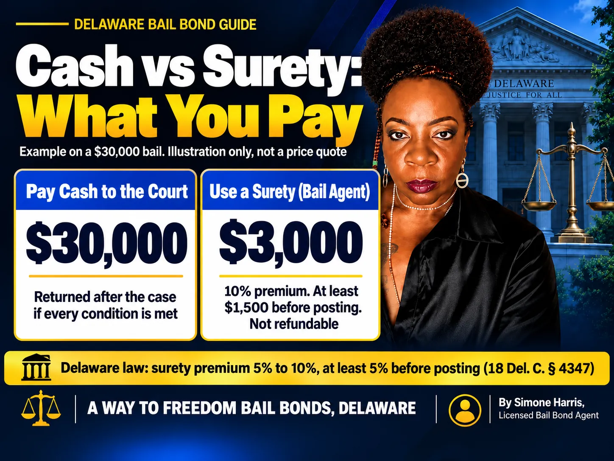

# What Is a Cash Surety Bond? How Cash or Surety Bail Works in Delaware

A cash surety bond is bail that can be paid in one of two ways: you pay the full amount in cash to the court, or a licensed bail agent posts a surety bond for you and charges a premium. When a bail order or jail listing says "cash/surety," it's telling you both doors are open. You pick one.

The choice matters because the two routes cost very different amounts and work differently when the case ends. Cash posted with the court can come back to the person who posted it. A bail agent's premium doesn't. This guide explains how the "cash or surety" choice fits Delaware's bail rules, what it costs on a $5,000, $30,000 or $100,000 bond, and what to check before you sign anything.

> A cash surety bond means bail can be satisfied with the full amount in cash or through a surety bond from a licensed bail agent. In Delaware, a surety bond over $1,000 costs a premium of 5% to 10%, and at least 5% must be paid before the agent can post it.

## What Is a Cash Surety Bond?

"Cash surety" isn't a special product you buy. It's shorthand for bail that the court will accept in either form.

With cash, someone pays the whole bail amount directly to the court and no bail agent is involved. With a surety, a licensed bail agent backed by an insurance company guarantees the full amount to the court; you pay the agent a premium and sign an agreement promising the defendant will go to court.

Either way, the purpose is the same: the court gets a financial promise that the defendant will come back for every hearing. The difference is who puts up the money and who carries the risk.

## How "Cash or Surety" Bail Fits Delaware's Secured Bail

Delaware courts use four main types of bail. The [Delaware Courts bail help page](https://courts.delaware.gov/help/bail/) lists them as own recognizance, unsecured, secured and cash only.

| Delaware bail type | What it means | Can a bail agent help? |
|---|---|---|
| Own recognizance (OR) | The defendant signs a promise to appear; no money is paid | Not needed |
| Unsecured | No money up front; a set amount is owed if the defendant misses court | Not needed |
| Secured | Security for the full amount must be posted, in cash or property, by the defendant or someone on their behalf | Yes, through a surety bond |
| Cash only | A set amount of money must be paid to the court | Not with a surety bond |

What other states call a "cash surety bond" is closest to Delaware's **secured bail**. The security can be cash you pay yourself, property, or a surety bond posted by a licensed agent. If you aren't sure which type was set, read [how to find out someone's bail amount](/blog/how-do-you-find-out-how-much-someones-bail-is) before you call anyone.

## Paying Cash vs Using a Surety: Side by Side

| | Paying cash to the court | Using a surety (bail agent) |
|---|---|---|
| Upfront cost | 100% of the bail amount | The agent's premium (10% at A Way to Freedom), with at least 5% before posting |
| Who is involved | The defendant or payer and the court | The defendant, a co-signer, the bail agent and the surety company |
| Money back after the case | Cash is returned to whoever posted it once the case is over, if the defendant met every condition | The premium is not returned; collateral is returned under the agreement |
| If the defendant misses court | The cash can be forfeited | The agent owes the court; the co-signer owes the agent and may lose collateral |
| Best fit | You can spare the full amount for months | You need release now without tying up the full amount |

For a closer look at the cash side, see [what a cash bond is](/blog/what-is-cash-bond). For the surety side, read [what a surety bond means in jail](/blog/what-is-a-surety-bond-jail).

## What a Cash Surety Bond Costs: $5,000, $30,000 and $100,000 Examples

Delaware law sets the range for surety premiums. Under [18 Del. C. § 4347](https://delcode.delaware.gov/title18/c043/sc02/index.html), the total filed premium on a surety bail bond over $1,000 must be between 5% and 10% of the bond, and the agent must receive at least 5% and sign a written contract before posting. A Way to Freedom Bail Bonds charges 10%.

| Bail amount | Cash route: paid to the court | Surety route: total premium (10%) | Minimum before posting (5%) |
|---|---|---|---|
| $5,000 | $5,000 | $500 | $250 |
| $30,000 | $30,000 | $3,000 | $1,500 |
| $100,000 | $100,000 | $10,000 | $5,000 |

So a "$100,000 cash surety bond" means you can pay $100,000 to the court, or work with a bail agent who charges about $10,000, with at least $5,000 paid before release. The balance of the premium can sometimes be paid later; see [how bail bond payment plans work](/blog/how-do-bail-bond-payment-plans-work). These are illustrations, not quotes. The bail amount, bond type and any collateral depend on the case.

The same section also says the premium can't be higher or lower than the rate the agent filed with the Delaware Department of Insurance, and agents can't add unfiled service or administrative fees. An offer that sounds cheaper than the filed rate is a warning sign, not a bargain.

## How to Post a Cash Surety Bond in Delaware, Step by Step

1. Confirm the bail type and amount from the court or the facility holding the defendant.
2. Decide whether to pay cash or use a surety, using the table above.
3. For cash, follow the court's instructions for where and how to pay, and keep the receipt.
4. For a surety, call a licensed Delaware bail agent with the defendant's full name, date of birth, location and bail amount.
5. Read and sign the indemnity agreement, and pay at least the minimum premium due before posting.
6. The agent posts the bond, and the defendant is released once the facility processes the paperwork.
7. Keep every receipt and make sure the defendant attends every court date.

The full release process is covered in the [bail bond process step by step](/blog/bail-bond-process-step-by-step).

## When Cash Is the Only Option

If the judge sets **cash-only bail**, a surety bond can't be used. The defendant or a co-signer must pay the set amount of money to the court and sign the bond order.

Delaware does license **property bail agents** who can post cash bail for someone. Under § 4347(f), their charge must be between 20% and 30% of the cash bail, and they must receive at least 20% before posting. That's a different service from a surety bond and costs more. The differences are explained in [secured bail vs cash-only bail in Delaware](/blog/secured-bail-vs-cash-only-bail-delaware).

## What Happens to the Money When the Case Ends?

On the cash route, the Delaware Courts page says that once the defendant's trial has concluded, the bail is returned to the person who posted it. That assumes the defendant made every appearance and followed every condition.

On the surety route, the premium pays for the agent's guarantee, so it isn't refunded, even if charges are dropped. Collateral, if any was pledged, is returned under the written agreement once the bond is discharged. More detail is in [do you get bail money back](/blog/do-you-get-bail-money-back).

## What Happens If the Defendant Misses Court?

On the cash route, the court can forfeit the cash that was posted. On the surety route, the agent is responsible to the court for the full bond, and the co-signer's agreement usually lets the agent recover that loss, so pledged collateral can be at risk.

In both cases the court can issue a warrant, and the defendant may face stricter bail later.

If a court date is missed, call the bail agent and a defense attorney right away. Acting quickly gives the defendant the best chance to fix it.

## How to Choose Between Cash and Surety

Paying cash makes sense when you can spare the full amount for the months a case can take and you're confident the defendant will appear. Using a surety makes sense when the full amount would empty your savings, or when you need the money for rent, bills or a lawyer.

Ask yourself three questions:

- Can we afford to have the full bail amount tied up until the case ends?
- Are we comfortable paying a premium we won't get back?
- Is the co-signer ready to be responsible if the defendant misses court?

## Frequently Asked Questions

### What is a $5,000 cash surety bond?

It means bail can be paid with $5,000 in cash to the court, or through a surety bond. At A Way to Freedom's 10% rate, the surety premium is $500, and at least $250 must be paid before the bond is posted in Delaware.

### What does a $100,000 cash surety bond mean?

You can pay $100,000 directly to the court, or use a licensed bail agent. At a 10% premium the surety cost is $10,000, with at least $5,000 before posting. The agent may also ask for collateral on a bond this size.

### How much does a $100,000 surety bond cost?

In Delaware, the total premium on a surety bail bond over $1,000 must be between 5% and 10% of the bond. At A Way to Freedom's 10% rate, a $100,000 bond costs $10,000.

### What does a $30,000 cash bond mean?

If the bail is cash only, $30,000 must be paid to the court. If it is cash or surety, you can instead use a bail agent: a $3,000 premium at 10%, with at least $1,500 before posting.

### Is a cash surety bond refundable?

Cash paid to the court is returned to the person who posted it after the case ends, if the defendant met every condition. A bail agent's premium is not refunded.

### Can I use a bail bondsman if the bail is cash only?

Not with a surety bond. Cash-only bail must be paid in money. A licensed Delaware property bail agent may post cash bail for a charge of 20% to 30%.

## Get Help With Bail in Delaware

A cash surety bond gives you a real choice, so take a minute to compare both routes before you pay. If someone you love is being held in Delaware, A Way to Freedom Bail Bonds can confirm the bail type, explain the 10% premium and the 5% due before posting, and walk you through the paperwork. [Contact us](/contact) any time, day or night. This article is general information about Delaware bail, not legal advice; questions about the charges belong with a defense attorney.
