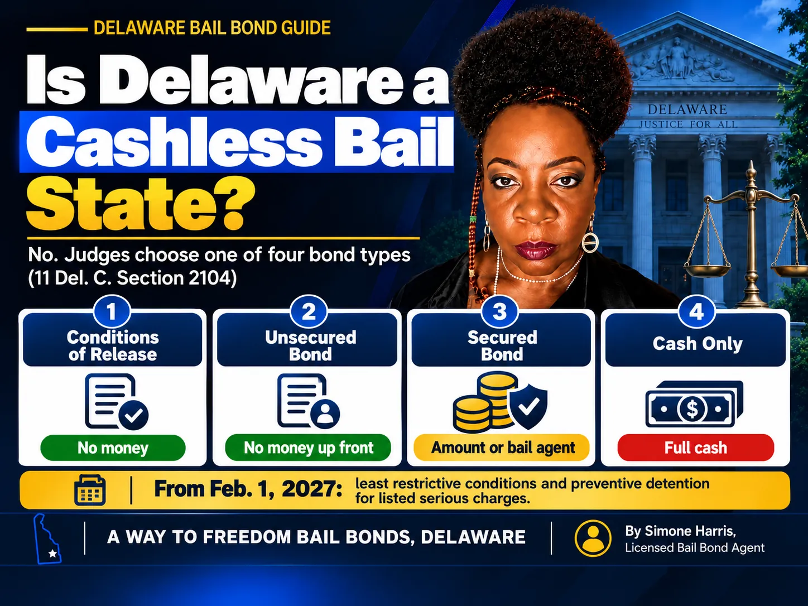

# What Is Cashless Bail? What It Means and How Delaware Handles It

Cashless bail is a system where people who are arrested are released before trial without having to pay money. Instead of a dollar amount, the judge decides whether the person can safely go home and sets conditions, like check-ins, a curfew or a no-contact order. People who are considered too dangerous or likely to flee can be held without bail after a hearing.

The phrase has become political, and news coverage often makes it sound like everyone walks out of jail for free. That isn't how it works anywhere, and it isn't how Delaware works. This guide explains what cashless bail means, what it doesn't mean, how Delaware's system works today, and what changes when Delaware's updated bail law takes effect on February 1, 2027.

> Cashless bail means pretrial release without a money payment, using conditions and supervision instead. Delaware is not a cashless bail state: judges can still set unsecured, secured or cash-only bail, though state law prefers non-money conditions when they're enough. From February 1, 2027, Delaware also adds preventive detention for certain serious charges.

## What Cashless Bail Means

In a traditional money bail system, a judge sets a dollar amount. If you can pay it, or pay a bail agent's premium to post a bond, you go home. If you can't, you wait in jail, sometimes for months, even though you haven't been convicted.

A cashless system removes money from that decision. The judge asks two questions: is this person likely to come back to court, and are they a danger to anyone? Release comes with conditions that fit the answers. In places that use it, judges usually also have a way to hold the highest-risk defendants without bail after a hearing.

People sometimes say "cashless bond" or "no bail" for the same idea. Be careful with "no bail," though. On a warrant or court order, "no bail" usually means the opposite: the person is held and can't be released until a judge reviews the case. Our guide on [bail for a bench warrant](/blog/how-much-is-bail-for-a-bench-warrant) explains that use of the term.

## What Cashless Bail Is Not

- It isn't automatic release. A judge still decides, and can refuse release in serious cases.
- It isn't release without rules. Conditions like reporting, curfews, electronic monitoring or no-contact orders are common.
- It isn't the end of consequences. Missing court or breaking conditions can lead to a warrant and detention.
- It isn't a dropped case. The charges stay the same; only the release decision changes.

## Is Delaware a Cashless Bail State?

No. Under [11 Del. C. § 2104](https://delcode.delaware.gov/title11/c021/index.html), a Delaware judge releases a person charged with a non-capital crime on one of four types of bond:

| Bond type | Money needed to get out |
|---|---|
| Conditions of release bond | None |
| Bond not guaranteed by financial terms (unsecured) | None up front; owed only if court is missed |
| Bond guaranteed by financial terms (secured) | The bond amount, or a bail agent's premium |
| Secured by cash only | The full cash amount |

The first two options involve no money up front, and many people in Delaware are released that way. Delaware's law has favored reasonable non-money conditions since its 2018 reforms, and courts also use a pretrial risk assessment tool. But secured and cash-only bail still exist, so money can still decide whether someone goes home. That's the difference between Delaware and a fully cashless system.

If you're trying to understand the money options, see [what is unsecured bail](/blog/what-is-unsecured-bail-delaware) and [secured bail vs cash-only bail in Delaware](/blog/secured-bail-vs-cash-only-bail-delaware).

## Delaware's Bail Law Changes on February 1, 2027

Delaware has passed a new version of its bail chapter that takes effect on February 1, 2027. Based on the version published in the Delaware Code:

- Courts must aim for the least restrictive conditions of release that still reasonably assure appearance, safety and the integrity of the case, while accounting for each defendant's right to pretrial liberty (§ 2101).
- When available, the court must use an empirically developed risk assessment tool, plus a separate tool in suspected domestic or intimate partner violence cases. The results aren't binding on the judge (§ 2104(e)).
- For a listed set of serious charges, such as Class A felonies, first-degree robbery, first-degree burglary, strangulation and certain gun, sex and child-abuse offenses, the court can order preventive detention without bail after a hearing (§§ 2107(c) and 2116).
- When money bail is set, it must not be oppressive, and the court must document its reasons for the type and amount (§ 2107).

The four bond types stay in the law. So even after February 1, 2027, Delaware will still have secured and cash-only bail. It won't be a fully cashless state.

## Where the Debate Stands

Cashless bail is argued about nationally. Supporters say money bail jails people for being poor, not for being dangerous, and that conditions and preventive detention are a better way to protect the public. Critics say removing money bail can mean more people missing court or being re-arrested, and that bail creates a strong reason to come back.

In August 2025, the White House issued [Executive Order 14340](https://www.whitehouse.gov/presidential-actions/2025/08/measures-to-end-cashless-bail-and-enforce-the-law-in-the-district-of-columbia/), directing federal measures against cashless bail policies in the District of Columbia. Bail rules for Delaware state cases, however, are set by Delaware law and Delaware courts.

## What This Means If Someone Is Arrested in Delaware

1. The judge will set one of the four bond types at the first appearance. Our guide to [what a bond hearing is](/blog/what-is-a-bond-hearing) walks through it.
2. If the bond is a conditions of release bond or unsecured, no money is needed to get out. Follow every condition.
3. If the bond is secured, you can post it in full or use a licensed bail agent. In Delaware, the premium on a surety bond over $1,000 is 5% to 10%, with at least 5% before posting ([18 Del. C. § 4347](https://delcode.delaware.gov/title18/c043/sc02/index.html)).
4. If the bond is cash only, a surety bond can't be used; see [what a cash surety bond is](/blog/what-is-a-cash-surety-bond) for how cash and surety options differ.
5. From February 1, 2027, ask a defense attorney whether the charge is on the preventive detention list, since that changes what can happen at the hearing.

## Frequently Asked Questions

### What is cashless bail in simple terms?

It's pretrial release without paying money. A judge decides whether the person can safely go home and sets conditions, instead of setting a dollar amount. High-risk defendants can be held after a hearing.

### Is Delaware a cashless bail state?

No. Delaware judges can release people on conditions or unsecured bonds with no money up front, but they can also set secured or cash-only bail. That stays true after the law changes on February 1, 2027.

### What does "no bail" mean?

In everyday talk, some people use it to mean cashless release. On a court order or warrant, "no bail" usually means the person can't be released until a judge reviews the case.

### What is preventive detention in Delaware?

Starting February 1, 2027, Delaware courts can order certain defendants held without bail after a hearing if they're charged with offenses on a list in § 2116, such as Class A felonies, first-degree robbery and certain violent or sex offenses.

### Is cashless bail the same as being released on your own recognizance?

They're close. Release on your own recognizance means a signed promise to return, with no money. In Delaware, the closest match is a conditions of release bond.

### Do you still need a bail bondsman in Delaware?

Sometimes. If the judge sets a secured bond, a licensed bail agent can post it for a premium. If the bond is unsecured or a conditions of release bond, you don't need one.

## Get Clear Answers About Bail in Delaware

Cashless bail is a big national debate, but what matters to a family is simple: what bond did the judge set, and what does it take to get your loved one home? If the bond is secured, A Way to Freedom Bail Bonds can confirm the amount, explain the 10% premium and the 5% due before posting, and handle the paperwork any time, day or night. [Contact us](/contact). This article is general information about Delaware bail, not legal advice; questions about a specific case belong with a defense attorney.
