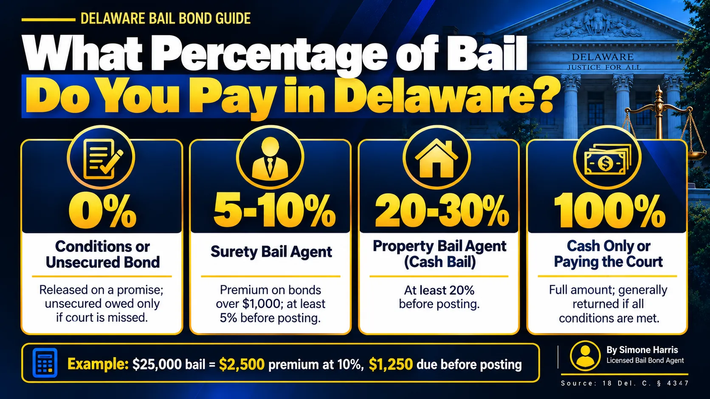

# What Percentage of Bail Do You Pay? A Delaware Guide

There isn't one percentage. What you pay depends on the type of bail the judge sets and on who posts it. In Delaware, some people pay nothing at all to get out. Others pay a bail agent a premium of 5% to 10% of the bond. And when bail is cash only, or when you post it yourself, you pay the whole amount.

The 10% figure people hear about is the bail agent's fee, not a discount on bail. The agent guarantees the full amount to the court, and you pay the agent for that guarantee. This guide breaks down each option, the limits Delaware law puts on the percentage, and what you'd pay on common bail amounts.

> In Delaware you pay 0% on a conditions of release or unsecured bond, 5% to 10% of the bond as a premium when a licensed surety bail agent posts a secured bond over $1,000, and 100% when you post the full amount yourself or the bail is cash only. A Way to Freedom Bail Bonds charges 10%, with at least 5% due before posting.

## The Short Answer by Bond Type

| How the bail is handled | What you pay | Refundable? |
|---|---|---|
| Conditions of release bond | 0% | Nothing to refund |
| Unsecured bond | 0% up front; the full amount is owed only if court is missed | Nothing paid |
| Secured bond posted by a surety bail agent | 5% to 10% premium on bonds over $1,000 | No, the premium is the agent's fee |
| Cash bail posted by a property bail agent | 20% to 30% of the cash bail | No, it's the agent's charge |
| Paying the full bail to the court yourself | 100% | Generally yes, if every condition is met |

The judge picks the bond type under [11 Del. C. § 2104](https://delcode.delaware.gov/title11/c021/index.html), usually at the first appearance. Our guide to [what a bond hearing is](/blog/what-is-a-bond-hearing) explains how that decision gets made.

## Why You Only Pay 10% With a Bail Agent

When a judge sets a secured bond, the court wants a guarantee that the full amount will be paid if the defendant doesn't come back. A licensed surety bail agent gives that guarantee by posting a bond backed by an insurance company. You pay the agent a premium for taking on that risk.

So the 10% isn't part of the bail. It's the price of the agent's promise. That's also why it isn't returned when the case ends, even if every court date was kept. Our article on [how a bail bond makes money](/blog/how-does-a-bail-bond-make-money) explains where the premium goes, and [how much a surety bond costs](/blog/how-much-is-a-surety-bond) covers the agent's side in more detail.

## Delaware's Legal Limits on the Percentage

Delaware doesn't leave the percentage up to each company. Under [18 Del. C. § 4347(b)](https://delcode.delaware.gov/title18/c043/sc02/index.html), the total filed premium on a surety bail bond over $1,000 must be at least 5% and no more than 10%. The agent also can't post the bond without first collecting at least 5% of the bond amount and signing a written contract with you.

There's a second, less common route. A property bail agent posts cash bail with its own money instead of an insurance-backed bond. Under § 4347(f), its total charges on cash bail must be between 20% and 30% of the amount posted, with at least 20% collected before posting.

Two more rules protect you. Agents can't add administrative or service fees that weren't filed with and approved by the Department of Insurance (§ 4347(c)). And the rate has to match what's on file, so an agent can't quietly charge more or less than its approved premium.

## What You'd Pay: Worked Examples

These examples use a 10% surety premium, which is what A Way to Freedom Bail Bonds charges, with 5% due before posting.

| Bail amount | Pay the court in full | 10% surety premium | Due before posting (5%) |
|---|---|---|---|
| $1,000 | $1,000 | $100 | Ask the agent (the 5% rule covers bonds over $1,000) |
| $5,000 | $5,000 | $500 | $250 |
| $25,000 | $25,000 | $2,500 | $1,250 |
| $250,000 | $250,000 | $25,000 | $12,500 |

On a large bond like $250,000, expect the agent to ask about collateral as well, since the risk is much higher. If the balance after the first 5% is hard to cover, a [bail bond payment plan](/blog/how-do-bail-bond-payment-plans-work) can spread it out, and some families put part of it on a card; see [whether you can pay bail with a credit card](/blog/can-you-pay-bail-with-a-credit-card).

For the full cost picture, including collateral and co-signers, read [how much a bail bond costs in Delaware](/blog/how-much-does-a-bail-bond-cost-in-delaware).

## When You Pay 100%

You pay the full amount in two situations.

The first is when you post the bail yourself. If the bond is secured and you have the money, you can deposit the whole amount with the court instead of using an agent. The upside is that it's generally returned after the case if every condition was met, minus anything the court keeps. Our guide on [whether you get bail money back](/blog/do-you-get-bail-money-back) covers when that happens.

The second is cash-only bail. A surety bond can't be used, so the full amount has to be paid in money. See [secured bail vs cash-only bail in Delaware](/blog/secured-bail-vs-cash-only-bail-delaware) and [what a cash bond is](/blog/what-is-cash-bond). If the order allows a choice between cash and surety, [what a cash surety bond is](/blog/what-is-a-cash-surety-bond) compares the two.

## When You Pay Nothing

Many people in Delaware are released without paying anything. A conditions of release bond is a signed promise to come back to court and follow the conditions. An unsecured bond has a dollar amount, but nothing is paid unless the person misses court. Read [what is unsecured bail](/blog/what-is-unsecured-bail-delaware) for how those work.

Delaware's updated bail law, effective February 1, 2027, keeps these four bond types and tells courts to use the least restrictive conditions that are enough. Our guide to [cashless bail and how Delaware handles it](/blog/what-is-cashless-bail) summarizes the changes.

## Can the Percentage Be Lowered?

The premium percentage itself is fixed by the agent's filed rate, so you can't bargain it below that. What can change is the bail amount. A defense attorney can file a motion to modify bond to ask for a lower amount or a different bond type. A lower bail means a lower premium, and a switch to unsecured means nothing to pay at all.

## Frequently Asked Questions

### What is 10% of a $5,000 bond?

$500. That's the total premium at a 10% rate. In Delaware, at least 5%, or $250, must be paid before the agent posts the bond.

### Do you have to pay the full amount of a bond?

Only if you post it yourself or the bail is cash only. With a licensed bail agent on a secured bond, you pay the premium, 5% to 10% in Delaware, and the agent guarantees the rest.

### How much is bail on a $1,000 bond?

If you pay the court directly, $1,000. Through a bail agent at 10%, the premium is $100. Delaware's 5% minimum before posting applies to surety bonds over $1,000, so ask the agent what's due up front.

### What does a $25,000 bail mean?

It means $25,000 is the amount the court needs to be guaranteed. You can deposit all of it if the court allows, or, if the bond is secured, pay a bail agent a $2,500 premium at 10%, with $1,250 due before posting.

### If bail is $250,000, how much do I pay?

At a 10% premium, $25,000, with at least $12,500 due before posting in Delaware. The agent will likely also ask for collateral on a bond that size.

### Do you get the 10% back?

No. The premium is the agent's fee for posting the bond, so it isn't refunded, even when the case ends well. Money you post directly with the court is a different story.

## Get Help With Bail in Delaware

Knowing the percentage is the easy part. The real question is which bond the judge set and what's due right now. A Way to Freedom Bail Bonds can confirm the bond type and amount, explain the 10% premium and the 5% due before posting, and get the paperwork started any time, day or night. [Contact us](/contact). This article is general information about Delaware bail, not legal or financial advice.
